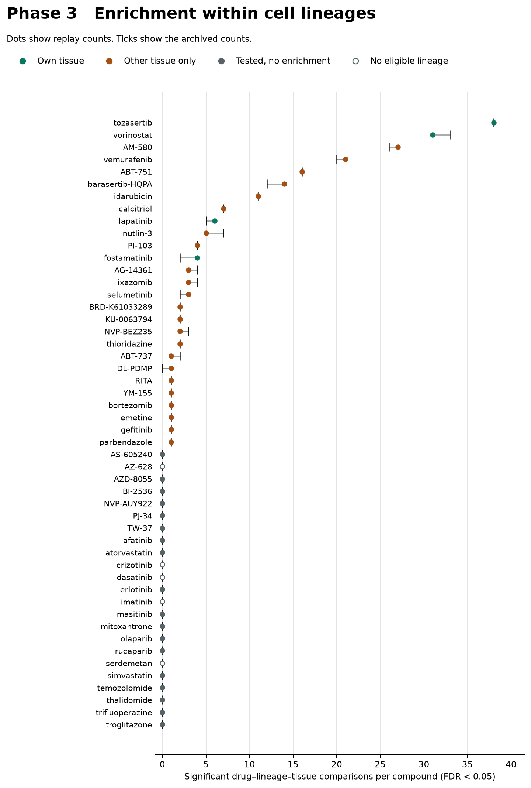

# Phase 3: Within-lineage enrichment

This exploratory phase ranked genes within CMap drug–lineage groups and used preranked gene-set enrichment against the combined GTEx v8 tissue sets. It collapsed the outputs to one category per compound. The archived table classifies 3 compounds as A (own-tissue), 23 as B (other tissue) and 24 as C (no significant enrichment under these rules).

The notebook originally read positive GTEx effect sizes as male-biased and used the sign of the normalized enrichment score to assign sex direction. Those labels are unreliable. In GTEx v8, positive `effsize` represents higher expression in females. In GSEA, the sign indicates where a set falls in the ranked gene list. Phase 4 separated the reference sets by the GTEx sign. The stored Phase 3 enrichment results remain available with their original labels.

The replay covered all 86 eligible compound–lineage groups. It classified four compounds as own-tissue, 23 as other-tissue and 23 as having no hit (18 tested, five without an eligible lineage). Fostamatinib gained an own-tissue hit in blood-derived lines. DL-PDMP gained an other-tissue hit in large-intestine lines. Both comparisons involved the GTEx EBV-transformed lymphocyte set. The archive retains 65 individual scores across the screen and omits the original score for each of these two comparisons. [Compound results](../verification/source_replay/phases2_5/comparison/phase3_compounds.csv) · [Fostamatinib](../verification/source_replay/phases2_5/phase3_literal/home_tissue_scores.csv) · [DL-PDMP](../verification/source_replay/phases2_5/phase3_dl_pdmp/target_tissue_scores.csv)

[Notebook](Phase3_PerLineage_GSEA.ipynb) · [Compound classifications](phase3_classification_final.csv) · [Category figure](phase3_classification_chart.png)

[Next: split tissue gene sets](../Phase4_SplitLibraries_DirectionFix/README.md) · [Fellowship overview](../README.md#how-the-analysis-developed)
