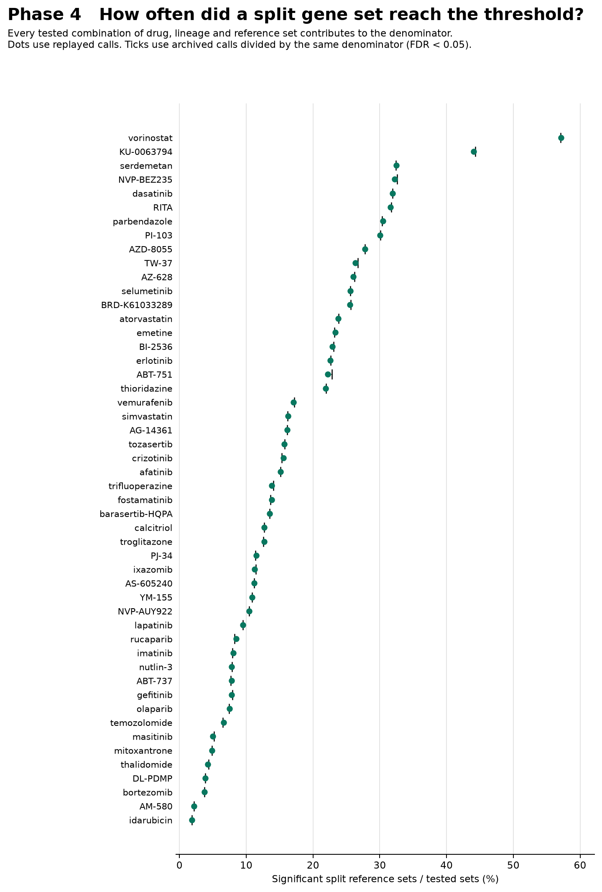

# Phase 4: Split GTEx gene sets

This exploratory phase averaged the CMap level-5 z-scores within each drug–lineage pair, ranked all mapped genes, and tested separate female- and male-biased GTEx sets. The identity of the enriched reference set and the sign of the normalized enrichment score describe different parts of the result. These pooled responses cannot estimate a difference between donor-sex groups.

In GTEx v8, positive `effsize` denotes higher expression in females. XIST (ENSG00000229807) has positive values in all 44 reported tissues, including +10.07 in lung. The corrected code places XIST in the female-biased lung set. One working notebook shows an initial reversed split and the subsequent rebuild before enrichment.

- [Notebook with the corrected split](Phase3_PerLineage_GSEA%20new.ipynb)
- [Second saved copy of the corrected code](Phase3_PerLineage_GSEA%20%283%29.ipynb)
- [Working notebook showing the initial split and correction](%3D%3D%3D%3D%3D.ipynb)
- [Classification output](phase4_classifications_final.csv) · [Other saved export](phase4_classifications_final%20%281%29.csv) · [Per-compound category figure](phase4_stacked_per_drug.png)

Both exports list the same 9,179 significant sets (237 own-tissue and 8,942 other-tissue). Each of the 81 pairs without a significant set contributes one additional placeholder row. The Phase 3 table counts compounds, so its counts use a different denominator. The lapatinib lung example enriched seven female-biased sets among eight significant sets in that comparison.

The replay tested 53,064 split gene sets across 603 compound–lineage groups. Of the 9,179 archived hits, 54 fell above or at FDR 0.05 on replay. Another 35 crossed below it. In placenta lines treated with NVP-BEZ235, the female-biased minor salivary gland set had an archived FDR of 0.005 and a replay FDR of 0.503. With the same gene ranking, changing the permutation seed or increasing the permutation count moved it back below 0.05. [Changed calls](../verification/source_replay/phases2_5/comparison/phase4_changed_threshold_calls.csv) · [Permutation results](../verification/source_replay/phases2_5/phase4_literal/target_seed_tests.csv)

[Next: signature categories](../Phase5_PerSignature_Categories/README.md) · [Fellowship overview](../README.md#how-the-analysis-developed)
