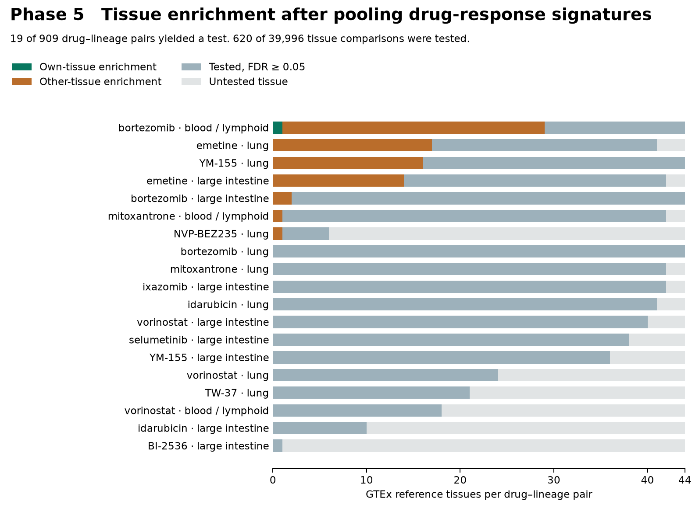

# Phase 5: Tissue enrichment by compound and cell lineage

Phase 5 ranked the pooled response within each compound–lineage pair after restricting genes to an absolute mean z-score above 2. It required five distinct cell lines in each donor-sex group. A downstream export assigned each signature the best category for its compound–lineage pair. The four categories distinguish own-tissue enrichment, other-tissue enrichment, a tested pair with no significant enrichment, and an untestable comparison.

The file named [per_signature_categories.csv](results/per_signature_categories.csv) has one row per drug, lineage and tissue. It records 620 completed comparisons across 19 drug–lineage pairs (1 A, 79 B, 540 C), with 39,376 comparisons untested. The sole own-tissue enrichment was bortezomib in blood lines against the GTEx EBV-transformed lymphocyte set. In the [pair summary](results/per_drug_lineage.csv), the `analysed` flag is true only for four pairs with no recorded skip reason. To find every pair with at least one test result, count those with A + B + C greater than zero.

All 39,996 categories reproduced. GSEApy 1.3.1 reproduced all 620 tested normalized enrichment scores and false discovery rates at the saved precision. GSEApy 1.2.1 changed 14 false discovery rates by at most 0.001 without changing a call. The original notebook did not record the package version. The archived `sex_lean` field encodes the sign of an enrichment score from pooled profiles and mixed GTEx gene sets. It identifies which end of the ranking contains the set. The treatment difference between donor groups was not estimated in this phase. [Software comparison](../verification/source_replay/phases2_5/comparison/phase5_software_versions.csv)

Start with the [notebook](project59_pipeline.ipynb) and [reference inputs](reference/). The output folder includes a [multi-sheet export with the pair-level table](results/FULL_50drugs_table.xlsx), [per-drug counts](results/all50_drug_counts.xlsx), and [working exports at different levels of aggregation](results/). The additional workbooks cover different rows or values and are kept with their original filenames. Use the Phase 6 tables for counts after the per-pair cell-line minimum was removed.

[Next: full screen](../Phase6_NoSampleFilter/README.md) · [Fellowship phases and reproduction](../fellowship/README.md)
