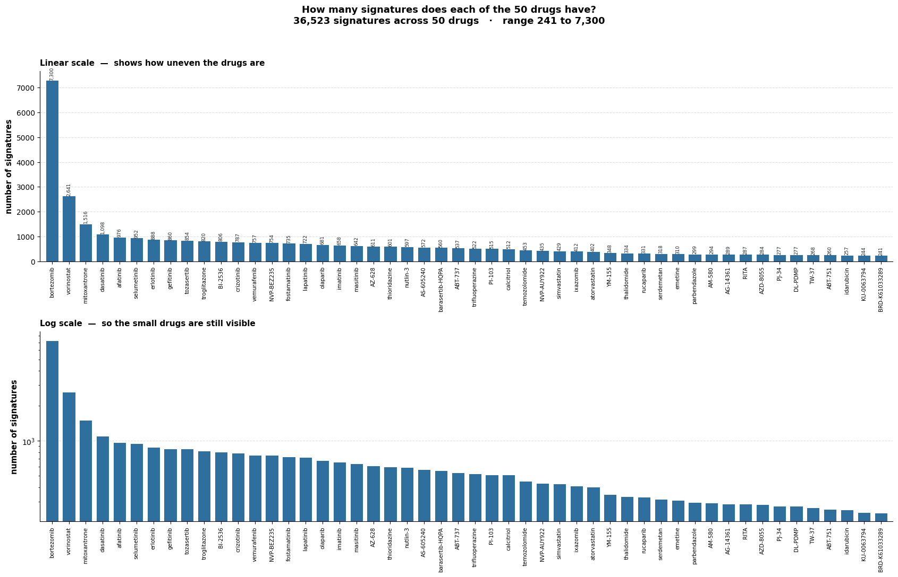

# Phase 6: Full CMap and GTEx screen

This exploratory screen pooled CMap perturbation signatures by drug and cell lineage, then compared the ranked genes with GTEx tissue gene sets. Removing the five-lines-per-sex requirement within a drug–lineage pair made more pairs eligible. The requirement still applied when selecting the 50 compounds across all lineages.

The batch kept at least three signatures per pair and genes with absolute mean z-score above 2. GSEA required at least 15 matching genes per set. The batch used one combined sex-biased gene set per GTEx tissue.

## Screen results

The panel covered 36,523 signatures from 135 cell lines across 20 lineages. Comparing the 909 drug–lineage pairs with 44 tissues produced 39,996 candidate comparisons.

| Category | Meaning | Comparisons | Signatures |
| --- | --- | ---: | ---: |
| A | Enrichment in a GTEx tissue mapped to the cell lineage | 29 | 2,656 |
| B | Enrichment in another GTEx tissue | 717 | 5,163 |
| C | Tested, with no significant enrichment | 5,376 | 4,684 |
| D | No test outcome | 33,874 | 24,020 |
| Total | | 39,996 | 36,523 |

The first count uses drug–lineage–tissue comparisons. Each signature inherits the best category of its drug–lineage pair across tissues, in order A, B, C, D. Seventeen compounds reached A or B, including six that reached A. Category D includes lineages with no mapped GTEx tissue, pairs with too few signatures or ranked genes, and gene sets that did not yield GSEA results. [Category totals](results/category_totals.csv) · [Per-compound counts](results/signature_ABCD_per_drug.csv) · [Untested comparison reasons](results/category_D_skip_reasons.csv)

The table above gives the recorded run. A replay using GSEApy 1.3.2 returned 718 B and 5,375 C comparisons, with the A and D totals unchanged. Nine comparisons changed category, five from C to B and four from B to C. All A and D labels and the counts of compounds reaching any enrichment or own-tissue enrichment agreed. Among the 6,122 completed tests, the largest absolute FDR change from the archived screen was 0.4104. Eight signatures inherited a different best category, all for idarubicin in stomach lines. [Nine changed comparisons](results/replay_category_changes.csv) · [NES and FDR for all 6,122 tests](results/tested_tissue_scores.tsv.gz)

## Follow-up comparisons

The four saved analyses cover three drug–lineage–tissue combinations. They used separate female- and male-biased GTEx sets. The bortezomib blood-line comparison against the EBV-transformed lymphocyte tissue set used the full mapped ranking (12,276 distinct Ensembl IDs from 255 signatures and 15 cell lines). The two hypothalamus analyses, one pooled and one restricted to BJAB, and the emetine lung-line analysis used the absolute mean z-score cutoff of 2. The emetine split-set comparison did not reach q < 0.05 for either set. The category in the CSV refers to the earlier pooled batch comparison. [Case tables](results/case_studies_split_library.csv) · [Enrichment figures](figures/)

The bortezomib EBV follow-up gave NES −1.606 for the female-biased set and +0.999 for the male-biased set. GSEA stored the corresponding empirical q values as 0.0 and 0.4874 using 1,000 permutations. A zero in the output reflects the estimator’s finite resolution. Rebuilding the four case studies from the provider matrix reproduced all eight NES and FDR values at the precision shown in the archived table. [Recomputed values](results/split_library_replay.csv)

| LINCS treatment and GTEx reference | Enrichment | Matched genes |
| --- | --- | --- |
| Bortezomib, blood lines · EBV-transformed lymphocytes | [Running scores](figures/05_bortezomib_CellsEBV_enrichment_catA.png) | [Gene ranks](figures/05b_bortezomib_CellsEBV_genes.png) |
| Bortezomib, blood lines · hypothalamus | [Running scores](figures/07_bortezomib_BrainHypothalamus_pooled_enrichment.png) | [Gene ranks](figures/06_bortezomib_BrainHypothalamus_pooled_genes.png) |
| Bortezomib, BJAB only · hypothalamus | [Running scores](figures/09_bortezomib_BJAB_BrainHypothalamus_enrichment.png) | [Gene ranks](figures/08_bortezomib_BJAB_BrainHypothalamus_genes.png) |
| Emetine, lung lines · visceral adipose tissue | [Running scores](figures/11_emetine_AdiposeVisceral_enrichment.png) | [Gene ranks](figures/10_emetine_AdiposeVisceral_genes.png) |

## Limits and inputs

These comparisons measure overlap with GTEx reference sets in pooled ranks. The screen has no direct donor-sex contrast, negative control or multiple-testing correction across the whole screen. Phase 7 found that two own-tissue pairs had at least two cell lines of each sex. The most profiled line supplied 23.9% of bortezomib blood-line signatures and 75.0% of YM-155 skin-line signatures. [Phase 7 audit](../Phase7_SexBalance_Audit/README.md)

The [Colab notebook](notebook/phase6_no_sample_filter.ipynb) preserves the original run. The [batch runner](code/01_batch_abcd.py) recomputes all 39,996 comparisons from LINCS2020 and GTEx. The [case-study script](code/02_case_study_plots.py) runs the four split-library comparisons from the same inputs. Both accept `--data` and `--out`. [Install and run](../fellowship/README.md#run-the-fellowship-analyses). The [source notes](sources/README.md) list the inputs and explain how to prepare them. The saved batch file name `per_signature_v4_ABCD.csv` refers to the drug–lineage–tissue table and is distinct from the signature-level output.

[Project and manuscript](../README.md) · [Fellowship phases and reproduction](../fellowship/README.md)
