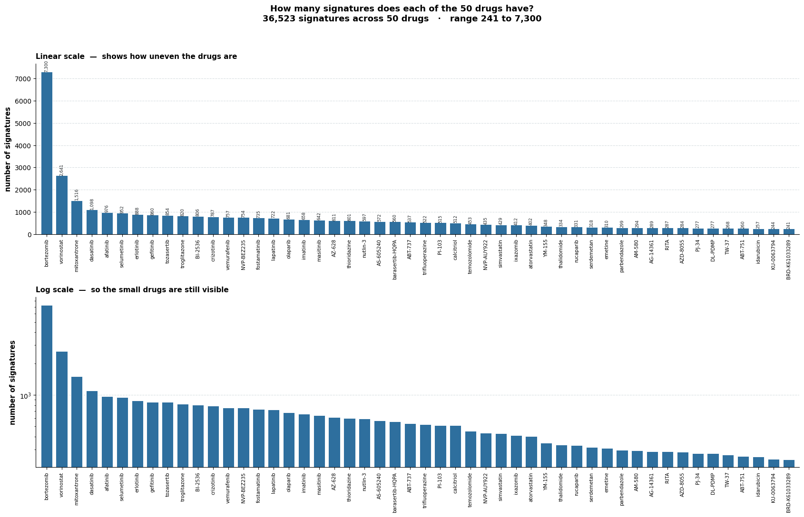
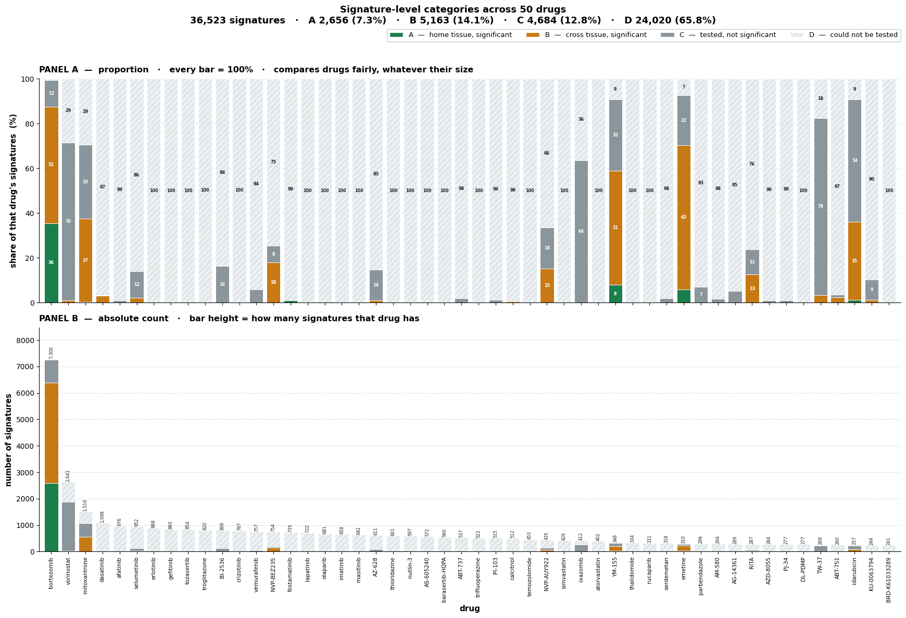
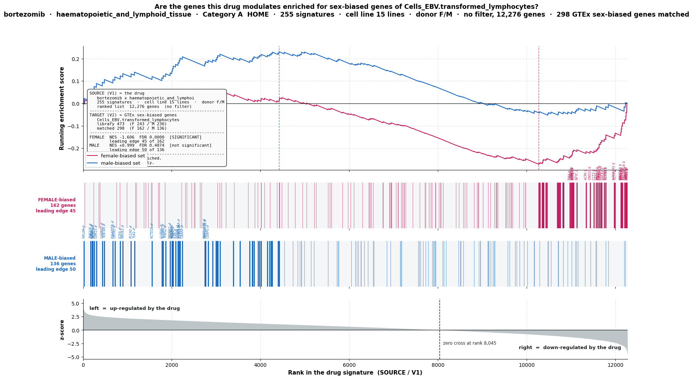
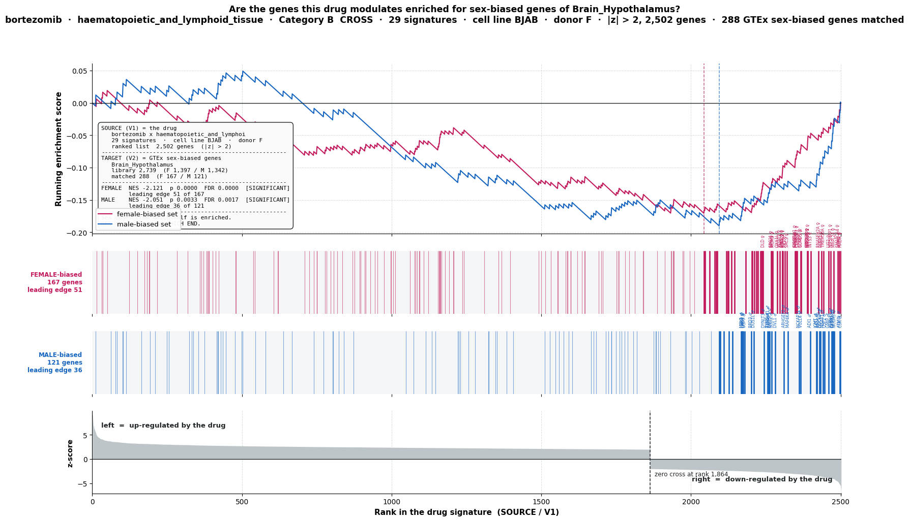
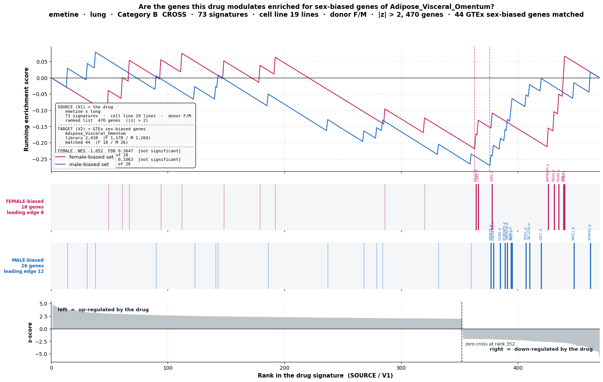

# Phase 6 — No sample-size filter

**What changed from Phase 5:** Marouen asked us to drop the sample-size filter.
In Phase 5 a drug × lineage pair was only tested if it had at least 5 male and
5 female cell lines. That rule threw away almost everything. Here it is gone.

**The only filter left on the data is `|z| > 2`.**

There is a second number that looks like a filter but is not ours: GSEA refuses
to run on a gene set smaller than 15 genes. That is `min_size=15`, the gseapy
and Broad default. We pass it; we did not invent it.

---

## The four questions Marouen asked, and the answers

| # | Question | Answer |
|---|----------|--------|
| 1 | Across the 50 drugs, how many signatures are there? | **36,523** |
| 2 | Map those signatures to A / B / C / D | A 2,656 · B 5,163 · C 4,684 · D 24,020 |
| 3 | Bar plot, one bar per drug, two panels | `figures/04_signature_ABCD_2panel.png` |
| 4 | Run the enrichment on one more drug | emetine × lung → Adipose_Visceral_Omentum |

---

## Step 1 — counting the signatures

A **signature** is one experiment: one drug, in one cell line, at one dose, for
one length of time.

```
signature  =  drug  ×  cell line  ×  dose  ×  time
```

GTEx tissue is **not** part of that. Tissue only enters later, when we compare
the signature's gene list against a tissue's sex-biased gene list. So
bortezomib has 7,300 signatures whether we test it against brain or against fat.

| | |
|---|---|
| signatures across the 50 drugs | **36,523** |
| cell lines | 135 |
| cell lineages | 20 |
| drug × lineage pairs | 909 |
| GTEx tissues | 44 |
| signature × tissue combinations | 36,523 × 44 = **1,607,012** |
| from female donors | 22,813 (62.5%) |
| from male donors | 13,710 (37.5%) |

**The drugs are very unevenly sampled.** Range 241 to 7,300 signatures, median 529.

| | |
|---|---|
| bortezomib alone | 7,300 — **20.0%** of everything |
| top 11 drugs | 50% |
| top 28 drugs | 80% |



The top panel is a normal (linear) axis — equal distance means equal number
added. It shows how lopsided the data really is, but squashes the small drugs
flat. The bottom panel is a log axis — equal distance means equal multiplication
— so the small drugs stay readable. Both show the same numbers.

`figures/02_signature_share_pareto.png` shows the same thing as shares, with a
running total. `results/signature_counts_per_drug.csv` has all 50 rows.

---

## Step 2 — giving every signature a category

| Category | Meaning |
|----------|---------|
| **A** | Significant, and the tissue is the cell line's own tissue (home) |
| **B** | Significant, but a different tissue (cross) |
| **C** | We tested it, nothing came out |
| **D** | We could not test it at all |

A/B/C/D is decided per **drug × lineage × tissue**. A signature inherits the
best category its drug × lineage reached across the 44 tissues (A beats B beats
C beats D).

### The same result counted three ways

| Level | A | B | C | D | total |
|-------|---|---|---|---|-------|
| drug × lineage × tissue | 29 | 717 | 5,376 | 33,874 | 39,996 |
| **signature (best of 44 tissues)** | **2,656** | **5,163** | **4,684** | **24,020** | **36,523** |
| signature × tissue | 2,828 | 93,247 | 396,645 | 1,114,292 | 1,607,012 |

The middle row is what the bar chart shows. 17 of the 50 drugs got any hit at all.



Panel A is proportion — every bar is 100%, so a small drug and a large drug can
be compared fairly. Panel B is the raw count — bar height is how many signatures
that drug has. Panel A answers "how did this drug do"; Panel B answers "how much
data is behind it".

### Why so much D

Every drug was attempted. D does not mean "skipped" — it means the test could
not run.

| Reason | Rows | What it means |
|--------|------|---------------|
| `gsea_empty` | 19,624 | GSEA returned nothing for that drug × lineage at all |
| `too_few_signatures_or_DE_genes` | 9,064 | fewer than 3 usable signatures, or nothing survived `|z| > 2` |
| `no_GTEx_home_tissue` | 2,948 | that lineage has no matching GTEx tissue, so A is impossible |
| `gene_set_too_small` | 2,238 | after matching with the GTEx library, fewer than 15 genes were left |

The last two rows are worth understanding, because they look like a hidden
filter and are not. The chain is:

```
12,328 genes measured
     |  |z| > 2                      <- the only filter we apply
   470 genes survive                    (emetine x lung, as an example)
     |  intersect with the tissue's GTEx sex-biased list
    44 matched
     |  split into female half and male half
  F 18 / M 26                        <- both above 15, so GSEA ran
```

If either half had come out below 15, gseapy would have refused and the row
would read `gene_set_too_small`. One filter, applied once, shrinks the list far
enough that GSEA's own minimum takes over. Targeted drugs suffer most:
erlotinib is 100% D because a kinase inhibitor moves few genes past `|z| > 2`.

---

## Step 3 — the case studies

Four pairs were worked through in detail. Full numbers in
`results/case_studies_split_library.csv`.

### bortezomib × blood → Cells_EBV.transformed_lymphocytes — Category A (home)

255 signatures, 15 cell lines, no `|z|` filter (full 12,276-gene list),
298 of the tissue's 473 sex-biased genes matched (F 162 / M 136).

| | NES | FDR | |
|---|---|---|---|
| female-biased set | −1.606 | 0.0000 | **significant** |
| male-biased set | +0.999 | 0.4874 | not significant |

The female half is enriched at the **suppressed** end of the ranked list and the
male half is not. This also answers Marouen's standing question about direction:
the drug's ranked gene list is the source (`rnk=`), the GTEx tissue list is the
target (`gene_sets=`) — we enrich the drug against the tissue, not the reverse.



### bortezomib × blood → Brain_Hypothalamus — Category B (cross)

Run twice, once pooled over the lineage and once in a single cell line.

| | signatures | ranked genes | matched | female NES / FDR | male NES / FDR |
|---|---|---|---|---|---|
| pooled, 15 cell lines | 255 | 2,047 | 223 (F 141 / M 82) | −2.556 / 0.0000 | −1.666 / 0.0201 |
| cell line BJAB, donor F | 29 | 2,502 | 288 (F 167 / M 121) | −2.121 / 0.0000 | −2.051 / 0.0017 |

Both halves land at the suppressed end here, so this is not a clean sex split —
it says bortezomib suppresses sex-biased genes of both kinds.



### emetine × lung → Adipose_Visceral_Omentum — Category B

73 signatures, 19 cell lines, 470 genes past `|z| > 2`, 44 matched (F 18 / M 26).

| | NES | FDR | |
|---|---|---|---|
| female-biased set | −1.052 | 0.3647 | not significant |
| male-biased set | −1.570 | 0.1063 | not significant |



---

## The thing to be careful about: two different gene-set definitions

This caused a result that looked like a contradiction, and it is not a bug.

| | gene sets | how many |
|---|---|---|
| `01_batch_abcd.py` → `run_gsea` | one set per tissue, all sex-biased genes together | 44 |
| `02_case_study_plots.py` → `_gsea` | each tissue split into a female half and a male half by `effsize` sign | 88 |

The batch table records emetine × lung → Adipose as significant. The split-half
plot records it as not significant. Both are correct — they are **two different
tests**, and their NES and FDR must never be quoted side by side as if they were
the same number.

Which one is right for the paper is a decision for Marouen, not something to
settle in code.

---

## What is not settled yet

These are open, written down so nobody mistakes them for conclusions.

**1. Category A is one drug.** Bortezomib supplies 2,593 of the 2,656
Category A signatures — **97.6%**. Only 6 of the 50 drugs have any A at all;
44 have none. See `results/category_A_concentration.csv`.

**2. Most A hits have no female cell lines.** Of the 29 pair-level Category A
hits, 20 have zero female cell lines and 1 has zero male. Only 8 have both
sexes present. Requiring more than one cell line per sex leaves **one** pair
standing: bortezomib × blood → Cells_EBV (10 M / 5 F, 255 signatures).

**3. The only sex-balance guarantee left is at drug level.** The ≥5 M / ≥5 F
rule ran in two separate places in Phase 5:

| where | grouped by | Phase 5 | Phase 6 |
|---|---|---|---|
| picking the 50 drugs (`project59_pipeline.ipynb`, cell 12) | **drug** | applied | **still applied** — `top50_names.json` unchanged |
| inside `per_lineage_DE_v2` (cell 44) | **drug × lineage** | applied | **removed** — Marouen's instruction |

Removing the second one was right: it was sending 36,124 rows to D. But what
survives is a guarantee at drug level only, while every result is produced per
lineage. Bortezomib qualifies on all 19 of its lineages pooled, yet
bortezomib × CNS has 2 male and 0 female cell lines.

This is not a bug — the code does exactly what it was told. It is a reporting
gap, and it is why 20 of the 29 Category A hits sit in lineages with no female
cell lines. The fix is not to re-add a filter but to carry an explicit
`sex_balanced` flag alongside each row, so the two groups can be reported
separately and Marouen can decide which to use.

**4. Brain subregions are counted as independent.** 19 of the 29 A hits come
from two CNS pairs spread across 13 correlated brain subregions. Treating those
as 13 hits overstates the evidence.

**5. No project-wide multiple-testing correction.** FDR is computed inside each
GSEA run. Across all 39,996 tests there is no Benjamini–Hochberg pass yet.

**6. No negative control.** DMSO, the solvent, should show nothing. It is not in
the 50, so we cannot yet prove the hits are drug-specific.

**7. The signature count is ambiguous.** "How many signatures" could mean 36,523
unique signatures or 1,607,012 signature × tissue combinations. We report
36,523. This needs confirming with Marouen.

---

## Folder map

```
Phase6_NoSampleFilter/
├── README.md              this file
├── notebook/              the Colab notebook, outputs kept
├── code/                  the pipeline, lifted out of the notebook
│   ├── 01_batch_abcd.py       reference loading, DE, GSEA, the batch loop
│   └── 02_case_study_plots.py build_V1, split_sets, _gsea, the two plot functions
├── figures/               11 PNGs, numbered in the order they appear above
├── results/               the summary tables
└── sources/               where every input file comes from
```

### results/

| File | What it holds |
|------|---------------|
| `dataset_facts.csv` | every headline number on this page, with its note |
| `signature_counts_per_drug.csv` | 50 rows: signatures, cell lines, lineages, share, cumulative |
| `signature_ABCD_per_drug.csv` | 50 rows: A/B/C/D counts and percentages |
| `category_totals.csv` | A/B/C/D at all three counting levels |
| `category_D_skip_reasons.csv` | the four reasons a test could not run |
| `category_A_concentration.csv` | the 6 drugs that have any A |
| `bortezomib_by_lineage.csv` | bortezomib's 19 lineages, A/B/C/D each |
| `case_studies_split_library.csv` | the four worked pairs, every number |

The two large per-row files — `per_signature_v4_ABCD.csv` (39,996 rows) and
`signature_level_ABCD.csv` (36,523 rows) — are produced by the notebook into
Google Drive and are not committed here.

---

## Re-running it

```bash
pip install cmapPy gseapy pandas numpy matplotlib openpyxl
```

Needs **Python 3.12 or newer** (the plotting code uses f-strings with escapes,
which is PEP 701 and only valid from 3.12 on; Colab is on 3.13).

1. Download `level5_beta_trt_cp_n720216x12328.gctx` (33 GB) — see `sources/`.
2. Run `code/01_batch_abcd.py` — about 24 minutes — to build the A/B/C/D table.
3. Run `code/02_case_study_plots.py` for the per-pair figures.

**Before running, check these two things** (the bug in Phase 5 was exactly this):

```python
len(sb_library_sets) == 44
type(list(sb_library_sets.values())[0]) is set     # a list here fails silently
len(cmap_to_gtex)    == 20
```
