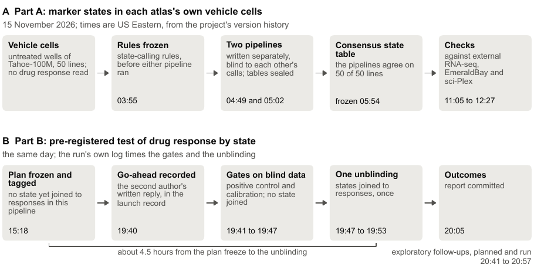

# Sex-chromosome expression and drug response

**Fatima Fellowship · Project 59**

Mateenah Jahan and Marouen Ben Guebila

[Fellowship manuscript (PDF)](manuscript/manuscript.pdf) · [Supplement (PDF)](manuscript/supplement.pdf) · [Manuscript figures](manuscript/figures/)

Can the recorded sex of a donor stand in for the sex-chromosome expression of a cultured cancer cell line? In Tahoe-100M, 27 of 49 lines with a donor annotation expressed a different combination of Y-linked genes and XIST than the annotation would predict. The RNA patterns agreed with independent RNA-seq in 47 of 49 lines. [Expression calls by cell line](analysis/data/tahoe-emeraldbay-expression-states.tsv)

We then asked whether the measured markers predicted drug-induced gene expression in LINCS2020. Across 114 compounds and 41 lines, neither panel test resolved a difference (Y *p* = 0.7231, XIST *p* = 0.1127). The intervals were wide, and XIST also showed an association in the vehicle control (*p* = 0.0323). [Panel and control results](verification/README.md) · [Reproduction from source data](verification/source_replay/)

## The eight fellowship phases

The project began with a single drug, vorinostat. As the screen grew to 50 compounds, the investigators found that thousands of signatures could come from a few heavily profiled lines. That observation motivated measuring sex-chromosome expression directly in the later manuscript. Phase 8 pursued a separate question about adverse-event reporting.

| Phase | What the analysis established | Evidence |
| --- | --- | --- |
| [1 · Vorinostat](Phase1_Vorinostat/) | Of 12,328 genes tested across 2,641 signatures from 116 lines, 20 passed both the adjusted *p* threshold and an absolute mean difference above 1. The test pooled repeated profiles. | [All gene tests](Phase1_Vorinostat/vorinostat_all_genes_results.csv) |
| [2 · Fifty compounds](Phase2_Fishers_50Drugs/) | One of 50 compounds qualified for own-tissue enrichment. Two genes drove that result. | [Fifty classifications](Phase2_Fishers_50Drugs/top50_drug_classification.csv) |
| [3 · Within-lineage enrichment](Phase3_PerLineage_GSEA/) | The archive counted three own-tissue compounds. The replay counted four. Two compounds changed category when genes with tied scores were reordered. | [50-compound comparison](verification/source_replay/phases2_5/comparison/phase3_compounds.csv) |
| [4 · GTEx direction check](Phase4_SplitLibraries_DirectionFix/) | The test ranked pooled drug responses against separate female- and male-biased GTEx sets. Of 9,179 archived enrichment calls, 9,125 reproduced. All 50 compounds retained their best category. | [Changed calls](verification/source_replay/phases2_5/comparison/phase4_changed_threshold_calls.csv) |
| [5 · Coverage under the cell-line minimum](Phase5_PerSignature_Categories/) | Only 620 of 39,996 drug–lineage–tissue comparisons yielded a test result. One showed significant enrichment in its own tissue. | [Comparison table](Phase5_PerSignature_Categories/results/per_signature_categories.csv) |
| [6 · Full CMap–GTEx screen](Phase6_NoSampleFilter/) | Relaxing the within-pair minimum brought 6,122 comparisons into the test. Seventeen of 50 compounds reached at least one tissue, including six that reached their own. The ranks pooled donor groups. | [Screen totals](Phase6_NoSampleFilter/results/category_totals.csv) · [Compound results](Phase6_NoSampleFilter/results/signature_ABCD_per_drug.csv) |
| [7 · Cell-line sampling](Phase7_SexBalance_Audit/) | Female-donor lines supplied 2,426 of the 2,656 own-tissue signatures, yet the category contained 17 female-donor and 18 male-donor lines. Bortezomib in breast lines alone contributed 1,875 female-donor signatures. | [Counts by line and donor group](Phase7_SexBalance_Audit/results/cell_lines_by_category_and_sex.csv) · [Counts by drug and lineage](Phase7_SexBalance_Audit/results/category_A_by_drug_lineage_sex.csv) |
| [8 · Adverse-event reporting](Phase8_SideEffects_FAERS/) | Among 18 drugs in the FAERS comparison, report volume tracked the fraction of events flagged. The drug-level comparison did not establish a difference between the two Phase 6 groups. | [Per-drug event counts](Phase8_SideEffects_FAERS/per_drug_events.csv) |

The **Tahoe-100M and LINCS2020 manuscript** follows this numbered series. Part A measures expression states in vehicle-treated cells. Part B tests their relationship to drug response within cell lineages. [Manuscript](manuscript/manuscript.pdf) · [Analysis code](analysis/) · [LINCS2020 result figure](manuscript/figures/fig4_partB.pdf)

## Follow-up in drug-treated Tahoe-100M cultures

The vehicle calls persisted across **98.71%** of eligible treated line–wells when each cell line received equal weight. COLO 205 accounted for 773 of 792 disagreements across 58,259 line–wells. Independent RNA and DNA assays in COLO 205 gave stronger signal on the measured long arm of chromosome Y than on the short arm. The chromosomal location of that material remains unknown. [Marker results](analysis/marker_stability/marker_transfer/independent_check.md) · [COLO 205 assays and figure](analysis/marker_stability/independent_colo205/)

Across two repeat plates, the same line’s response was more similar under matched drug–dose conditions than under mismatched conditions in all 24 eligible lines. Sharing a baseline marker group added little similarity between different lines (948 genes, difference in correlation 0.011, exact *p* = 0.204). [Gene-expression results](analysis/marker_stability/genomics_extension/) · [Donor-label comparison](analysis/marker_stability/donor_response/results.json)

This separate computational study was designed and run with Codex. [Follow-up paper and supplement (14 pages)](manuscript/followups/marker_stability/marker_stability.pdf) · [Data and reproduction instructions](analysis/marker_stability/)

## Reproducing the analyses

- **Fellowship phases.** Phases 1–7 link to the Colab notebooks and saved outputs. [CMap inputs](cmap/README.txt) · [GTEx inputs](gtex/README.txt) · [Phase 6 parameters and matrix setup](Phase6_NoSampleFilter/sources/README.md). Phase 8 provides the recorded per-drug counts from the FAERS queries.
- **Manuscript.** [Run the released-table checks](verification/README.md#run-the-checks). The [analysis guide](analysis/README.md) lists the public expression-state table, inputs, dependencies and external files needed for a full cell-level or permutation replay.
- **Drug-treated follow-up.** The [reproduction guide](analysis/marker_stability/README.md#reproduce-the-experiment) starts from the 14 plates and links to the compound, marker and expression analyses.

AI coding assistants contributed to the analyses and drafts. [Fellowship portfolio](https://mateenahjahan.github.io/#project-59) · [Code license](LICENSE)
