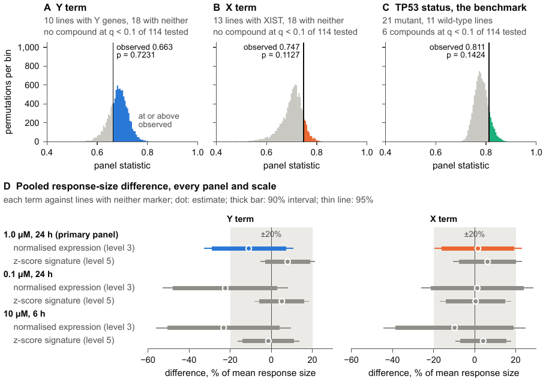

# Project 59: Sex-chromosome expression and drug response

Mateenah Jahan and Marouen Ben Guebila · Fatima Fellowship, 2026

## Current status

Revised working draft. [Manuscript PDF](manuscript/manuscript.pdf) · [Supplement PDF](manuscript/supplement.pdf) · [Figures](manuscript/figures/) · [Rerun results](verification/) · [Analysis source](analysis/)

In Tahoe-100M, 27 of 49 cell lines with a recorded donor sex had a sex-chromosome expression pattern different from the one expected for that label. The measured patterns agreed with external RNA-seq for 47 of 49 lines.

The LINCS2020 analysis tested 114 compounds across 41 lines. The panel-level p-values were 0.7231 for Y and 0.1127 for XIST. Wide intervals and a failed XIST vehicle control leave the drug-response result inconclusive.

[Tahoe-100M and EmeraldBay expression states](analysis/data/tahoe-emeraldbay-expression-states.tsv)

## Marker persistence in drug-treated cultures

Across 58,259 eligible Tahoe line–wells, the two RNA markers retained their vehicle classification in 98.71% of treated wells when each cell line received equal weight. COLO 205 accounted for 773 of the 792 disagreements. External RNA and DNA assays showed stronger signal on the measured long arm of chromosome Y in that line. The arrays cannot locate the retained material. On two repeat plates, the autosomal expression responses of 24 lines showed little additional similarity between lines sharing a marker group (948 genes, difference in correlation 0.011, exact p = 0.204).

This computational follow-up was prepared with Codex for review. [Follow-up manuscript and supplement (PDF)](manuscript/followups/marker_stability/marker_stability.pdf) · [Analyses and data](analysis/marker_stability/) · [COLO 205 source assays](analysis/marker_stability/independent_colo205/)

## How the analysis developed

The fellowship began with a vorinostat pilot. It then compared gene expression after drug treatment in CMap with tissue gene sets from GTEx. As the question shifted to enrichment within lineages, the later screen pooled responses across donor-sex groups. The Phase 7 audit counted the distinct cell lines behind the results.

| Phase | What was done | Files |
| --- | --- | --- |
| 1 · Vorinostat | Compared 2,641 signatures from 116 cell lines grouped by annotated donor sex. | [Phase 1](Phase1_Vorinostat/README.md) |
| 2 · Fifty compounds | Used Fisher’s exact test to compare drug gene lists with GTEx tissue gene sets. | [Phase 2](Phase2_Fishers_50Drugs/README.md) |
| 3 · Lineage comparisons | Ran gene-set enrichment within lineages and recorded drug-level categories. | [Phase 3](Phase3_PerLineage_GSEA/README.md) |
| 4 · Split gene sets | Separated female- and male-biased libraries and checked GTEx’s effect-size sign against XIST. | [Phase 4](Phase4_SplitLibraries_DirectionFix/README.md) |
| 5 · Signature categories | Assigned each signature a category based on its drug–lineage results. | [Phase 5](Phase5_PerSignature_Categories/README.md) |
| 6 · Full screen | Removed the five-lines-per-sex minimum within each drug–lineage pair. It still applied when selecting compounds. | [Phase 6](Phase6_NoSampleFilter/README.md) |
| 7 · Sampling audit | Counted distinct cell lines and measured the concentration of repeated profiles. | [Phase 7](Phase7_SexBalance_Audit/README.md) |

## What the exploratory screen found

Phase 6 covered 50 compounds, 36,523 signatures, 135 cell lines, 20 lineages and 44 GTEx tissues. The screen assigned an outcome to 6,122 of 39,996 drug–lineage–tissue comparisons. Seventeen compounds had a significant enrichment in at least one tissue and six had one in a tissue mapped to the cell lineage. Untested comparisons include lineages without a mapped tissue as well as pairs or gene sets that fell short of the method’s requirements. [Category totals](Phase6_NoSampleFilter/results/category_totals.csv) · [Per-compound counts](Phase6_NoSampleFilter/results/signature_ABCD_per_drug.csv)

The own-tissue category contained 2,656 signatures. About 91% came from female-donor lines, yet the signatures represented 17 female-donor and 18 male-donor lines. The female-donor lines were profiled about 11 times as often per line. The bortezomib breast-line pair alone contributed 1,875 signatures from lines with only female donor labels. The bortezomib blood-line pair passed both Phase 7 sampling checks. The earlier screen pooled the drug responses and did not test a sex-specific bortezomib effect. [Sampling audit](Phase7_SexBalance_Audit/README.md) · [Bortezomib case figure](Phase6_NoSampleFilter/figures/05_bortezomib_CellsEBV_enrichment_catA.png)

## Data and setup

The archived Colab notebooks use CMap LINCS2020 and GTEx v8. Each phase page links to its notebook and saved results. The complete expression matrix and GTEx archive are external inputs. [CMap data](cmap/README.txt) · [GTEx data](gtex/README.txt) · [Phase 6 inputs and parameters](Phase6_NoSampleFilter/sources/README.md) · [Dependencies](requirements.txt)

AI coding assistants helped develop and run analyses and prepare the draft. [Fellowship portfolio](https://mateenahjahan.github.io/#project-59) · [Code license](LICENSE)
