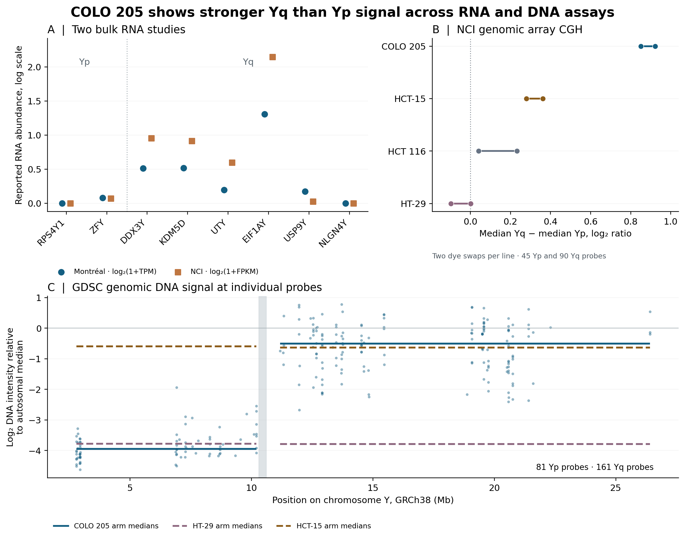

# Unequal Y-arm signal in COLO 205

COLO 205 accounted for 773 of 792 treated-well disagreements in the Tahoe marker-transfer analysis. Its baseline RNA score lay close to the original Y threshold. Two external RNA studies found little expression at the two Yp markers and measurable expression at several Yq markers. Genomic DNA arrays from the NCI-60, Broad CCLE and GDSC collections also showed more signal on Yq than Yp. An earlier NCI spectral karyotype recorded loss of an identifiable Y chromosome in nine metaphases. Together, these findings support an arm-level difference in the material detected and leave its physical location unresolved. [Tahoe analysis](../marker_transfer/independent_check.md) · [Original NCI karyotype](https://ftp.ncbi.nlm.nih.gov/sky-cgh/DATA/XML/NCI60_cell_line_panel_Genetics_Branch_I.R.Kirsch_1.xml)

## RNA from two cell collections

| Source | RPS4Y1 | ZFY | DDX3Y | KDM5D | UTY | EIF1AY | USP9Y | NLGN4Y | XIST |
|---|---:|---:|---:|---:|---:|---:|---:|---:|---:|
| Montréal IRIC, ATCC stock, TPM | 0 | 0.058 | 0.429 | 0.432 | 0.144 | 1.472 | 0.127 | 0 | unavailable |
| NCI-60, log₂(FPKM+1) | 0 | 0.070 | 0.956 | 0.914 | 0.596 | 2.145 | 0.026 | 0 | 0.024 |

The median of six Yq marker values exceeded the median of two Yp markers by 0.314 in Montréal on log₂(TPM+1) and by 0.720 in the NCI data on log₂(FPKM+1). NLGN4Y was zero in both and USP9Y was weak. The original Tahoe thresholds have different units. Montréal supplied one COLO 205 library from an ATCC culture. Its transcript file omits all annotated XIST transcripts. The Montréal HCT 116 sample, processed in the same study, had the opposite arm contrast (−1.328), and ACTB, GAPDH and RPLP0 exceeded 1,100 TPM in COLO 205. [GSM5857280](https://www.ncbi.nlm.nih.gov/geo/query/acc.cgi?acc=GSM5857280) · [CellMiner RNA-seq study](https://pubmed.ncbi.nlm.nih.gov/31113817/) · [Values and transcript counts](results/rna_genes.tsv)

## Genomic DNA

The table shows medians within each assay. The Agilent rows use submitted log₂(test/reference) ratios and the other arrays use raw log₂ intensity. All were centered on the array's autosomal median. Signals across platforms have different reference scales.

| Collection and assay | COLO 205 record | Yp / Yq probes | Yp | Yq | Yq − Yp |
|---|---|---:|---:|---:|---:|
| NCI-60, Agilent CGH, test DNA labeled red | GSM1181248 | 45 / 90 | +0.110 | +0.962 | +0.852 |
| NCI-60, same experiment, test DNA labeled green | GSM1181264 | 45 / 90 | −0.195 | +0.728 | +0.922 |
| NCI-60, Infinium 450K | GSM2087430 | 81 / 161 | −3.194 | −0.270 | +2.924 |
| Candiolo, NCI-derived line, Infinium 450K | GSM2293091 | 81 / 161 | −3.720 | −0.406 | +3.314 |
| Broad CCLE, ATCC-sourced, SNP 6.0 | GSM888007 | 2,552 / 5,879 | −1.642 | −0.247 | +1.395 |
| GDSC, Infinium 450K | GSM1669683 | 81 / 161 | −3.945 | −0.508 | +3.437 |

On the GDSC chip, COLO 205 Yp was in the range of HT-29 (−3.781) and HCT 116 (−3.465). Its Yq was close to HCT-15 (−0.636). The control-line Yq−Yp contrasts ranged from −0.063 to −0.002. The arm contrast persisted when the two Infinium chemistries were analyzed separately (+3.460 in type I and +3.429 in type II). The two NCI Agilent dye swaps had the largest two arm contrasts in the complete 129-array series. Computing from the unratioed test channels after flag filtering gave +0.971 and +0.909. Across the three control lines, subtracting the matching control at each probe before taking arm medians gave positive arm contrasts in all six comparisons (+0.487 to +0.865). Each pair of dye swaps measures one experiment. [GDSC sample](https://www.ncbi.nlm.nih.gov/geo/query/acc.cgi?acc=GSM1669683) · [GDSC measurements](results/gdsc_arm_medians.tsv) · [All Agilent arrays](results/agilent_arm_contrasts.tsv) · [Probe-matched controls](results/agilent_same_probe_line_contrasts.tsv) · [NCI, Candiolo and Broad probe analyses](nci_dna/) · [Agilent CGH study](https://doi.org/10.1371/journal.pone.0092047)

The NCI SKY archive identifies case 2801 as COLO205, submitted by Tonon, and cites Roschke et al. Its composite karyotype begins `69~75,XX,-Y[9]`. No Y-bearing derivative was annotated. This observation and the Yq probe signals refer to different preparations. Arrays do not locate the signal on a physical chromosome or discriminate retained Yq sequence from structurally altered material, X/Y cross-hybridization, or mixtures of subclones. The reported loss of a visible Y at metaphase and an X-only amelogenin call at one short-arm locus can coexist with signal from Yq probes. A same-passage Yp/Yq locus-specific FISH or independently aligned, matched genomic sequencing experiment would distinguish several of these explanations. [Archived case](results/sky_case_2801.xml) · [Cytogenetics paper](https://pubmed.ncbi.nlm.nih.gov/14695175/) · [NCI DNA fingerprint study](https://aacrjournals.org/mct/article/8/4/713/93541/)

## Sources, stock relationships and missing data

The case is COLO 205 (CVCL_0218, ATCC CCL-222, Broad ACH-001039, Sanger SIDM00826, COSMIC 905961). GDSC and the Cell Model Passports record describe the same model. Broad, CCLE and DepMap identifiers also lead to one model. The Montréal, Broad and Melbourne laboratories all described material from ATCC. The Candiolo assay used an NCI-derived line. The NCI CGH, NCI RNA and spectral karyotype were separately published assays of the NCI-60 collection. GDSC's individual sample record does not establish acquisition lot or a same-vial relationship to the other panels. There is one donor and no documented matched Tahoe, RNA, DNA and metaphase aliquot. This is external evidence for a pattern across cell-line records. It cannot estimate drug-induced DNA change, treatment response or prevalence across patients. [Cellosaurus](https://www.cellosaurus.org/CVCL_0218) · [ATCC](https://www.atcc.org/products/ccl-222) · [GDSC record](https://www.ncbi.nlm.nih.gov/geo/query/acc.cgi?acc=GSM1669683)

Melbourne purchased COLO 205 from ATCC and reported STR authentication. The Human610-Quad platform has 2,160 Y loci, but **each of its two public study matrices has exactly 584,888 autosomal rows and zero X, Y or XY rows**. The GEO sample has no supplementary files, the series directory lists only these two matrices, and ENA returned no runs for the linked BioProject PRJNA241105. This study supplies no measurement of Y in its public release. Another historical two-line karyotyping paper explicitly assigns its absent-Y observation to WiDr. It was excluded. [Melbourne study](https://pubmed.ncbi.nlm.nih.gov/24755471/) · [GEO](https://www.ncbi.nlm.nih.gov/geo/query/acc.cgi?acc=GSE55832) · [Probe coverage](results/wehi_coverage.tsv) · [WiDr and COLO 205 paper](https://pubmed.ncbi.nlm.nih.gov/1946816/)

## Methods and reproducibility

The eight Y genes and choice of COLO 205 came from the prior Tahoe result. The initial [protocol](protocol.md) preceded external measurements. The [addendum](protocol_addendum.md) records the correction to the NCI HCT 116 amelogenin label and which results had already been seen when GDSC was added. The line was selected for its unusually high Tahoe mismatch count. There is no independent patient replication and no test with probes treated as biological replicates.

For RNA, sum all available transcript TPM estimates using exact transcript versions from GENCODE v33. Independent parsing of the original GENCODE GTF reproduced all gene totals and missing entries. Use the submitted CellMiner log₂(FPKM+1) values directly. For Agilent CGH, map each non-control probe with a single reported hg17 coordinate. Drop ambiguous probe IDs, pseudoautosomal regions and centromere bands. This use of reported coordinates does not establish unique hybridization. Subtract the autosomal median and compare the medians of the two arms. Retain every array for panel context. For the raw-channel check, select the test DNA color in each sample, omit saturated and nonuniform features, and collapse repeated spots by probe. The sample records identify the reference only as “Reference.” For GDSC, decode both IDAT color files, combine the proper addresses for each design type, calculate log₂(1+total fluorescence) and center on the autosomal median. Exclude masked, ambiguously mapped, pseudoautosomal and centromeric probes using the same GRCh38 annotation as the other 450K experiments. All measurements are descriptive. [GENCODE release](https://www.gencodegenes.org/human/release_33.html) · [hg17 assembly](https://genome.ucsc.edu/cgi-bin/hgGateway?db=hg17) · [Infinium probe annotation](https://doi.org/10.1093/nar/gkw967)

Run from this directory with Python 3.12, NumPy, pandas, matplotlib, Beautiful Soup and requests. Use `python3 fetch.py` to download the public assay files, probe maps and study records and verify their checksums, followed by `python3 analyze.py`, `python3 gdsc.py`, `python3 verify.py` and `python3 plot.py`. Cross-laboratory IDAT and Broad SNP 6.0 commands are kept with their underlying analyses. [Sources and SHA-256](sources.tsv) · [Independent checks](results/verification.json) · [Raw test-channel sensitivities](results/agilent_raw_sensitivity.tsv) · [GDSC probe-design sensitivity](results/gdsc_by_probe_design.tsv) · [Additional DNA analyses](nci_dna/)
