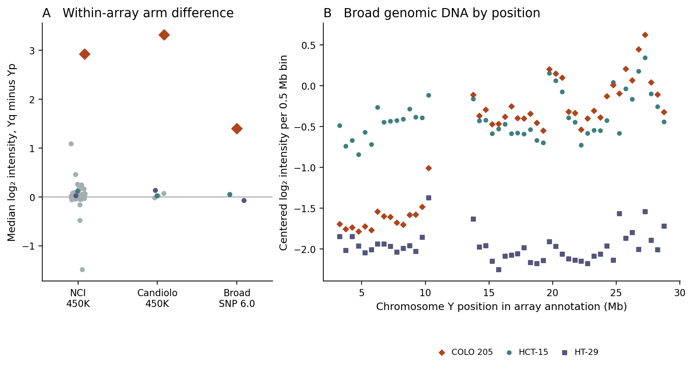

# Chromosome Y DNA signal in COLO 205

The Broad's CCLE group grew COLO 205 from ATCC and extracted genomic DNA from frozen cells. Its published gene-level copy-number table leaves the eight Y marker genes blank. Reading the raw SNP 6.0 array recovered 2,552 short-arm and 5,879 long-arm nonpolymorphic probe sets in clearly non-pseudoautosomal bands. The long-minus-short-arm difference was +1.395 log₂ units in COLO 205, +0.054 in HCT-15 and −0.073 in HT-29. Removing every manufacturer-flagged feature gave +1.394 in COLO 205. All three are named cell lines from the same CCLE experiment. Each difference is within one array. [Broad COLO 205 sample](https://www.ncbi.nlm.nih.gov/geo/query/acc.cgi?acc=GSM888007) · [CCLE paper](https://www.nature.com/articles/nature11003) · [Probe-set data](broad_y_probes.tsv.gz) · [All arm summaries](broad_summary.tsv)



The left panel compares medians across the measured arms. Gray points show the other available NCI reference lines. Orange diamonds identify COLO 205. The right panel shows Broad probe-set intensities by genomic position, summarized in 0.5 Mb bins after subtracting each sample’s autosomal median. DNA intensity depends on probe chemistry and platform. The three panel scales describe within-assay measurements.

| COLO 205 sample | Yp median | Yq median | Yq − Yp | Independent information |
|---|---:|---:|---:|---|
| NCI, GSM2087430 | −3.194 | −0.270 | +2.924 | Methylation-array DNA intensity, 81 Yp and 161 Yq probes |
| Candiolo, GSM2293091 | −3.720 | −0.406 | +3.314 | Separate extraction and scanner, NCI-supplied COLO 205, same probe design |
| Broad/CCLE, GSM888007 | −1.642 | −0.247 | +1.395 | ATCC-supplied COLO 205 grown at Broad, independent SNP-array design |

All entries are medians of log₂(1 + fluorescence) after subtracting the same array’s autosomal median. The position of Y-derived material, its copy number and the fraction of cells carrying it remain unknown. The historical [SKY record](../results/sky_case_2801.xml) found no identifiable Y chromosome in nine metaphases. These cultures share the identity of one cell line. Their measurements give no estimate of how common this pattern is across patients.

## Source and measurement checks

- **450K arrays.** Sum the methylated and unmethylated channels before taking logarithms. Keep human CpG probes outside the published general and mapping masks. Exclude both pseudoautosomal regions and centromeric bands in GRCh38. The final autosomal reference has 408,966 probes. A complete COLO 205 array has 81 Yp probes from 2.79 to 10.20 Mb and 161 Yq probes from 11.18 to 26.41 Mb. The distal long arm has no coverage in this set. Single-locus reference labels come from NCI CellMiner AMEL fingerprints. The additional NCI array RC0.1 has no matched entry in that collection. [Probe annotation](https://doi.org/10.1093/nar/gkw967) · [CellMiner fingerprints](https://discover.nci.nih.gov/cellminer/celllineMetadata.do) · [Source URLs and file hashes](sources.tsv)
- **Raw signal recovery.** Candiolo deposited intensities for only 13 of the 81 retained Yp probes in COLO 205. Counting only those raised its Yp median to −2.660. We decoded both raw color IDATs for COLO 205 and each of the five Candiolo comparison lines. Every overlapping Y probe in those six arrays and the NCI target agreed with the submitter’s raw signal within 0.000002 log₂ units. The figure and headline values use complete coverage. COLO 205 had the largest within-array arm difference among the 60 named NCI lines and among the six Candiolo lines for which we had NCI reference labels. The Candiolo comparison uses five controls, including a single AMEL X/Y line. [GSE79185](https://pmc.ncbi.nlm.nih.gov/articles/PMC5290136/) · [GSE86078](https://pmc.ncbi.nlm.nih.gov/articles/PMC5897187/) · [Raw and deposited values](idat_summary.tsv) · [All 450K comparison lines](complete_arm_medians.tsv) · [Individual probes](idat_probes.tsv) · [450K positions and reference distributions](complete_dna_intensity.pdf)
- **SNP 6.0.** Use every nonpolymorphic copy-number probe set assigned to the unambiguous interior bands Yp11.2 or Yq11.21 through Yq11.23. Discard annotated pseudoautosomal probes, terminal bands and the centromeric band. Summarize each probe set across physical features, then each arm across sets. The autosomal reference has 887,833 sets. Biopython independently decoded the same 6,892,960 feature intensities per CEL file. [Source files and hashes](broad_sources.tsv) · [Independent decoding check](cel_reader_check.json) · [Platform design](https://bioconductor.org/packages/release/data/annotation/html/pd.genomewidesnp.6.html)

## Reproduce

Use Python 3.11 or later with pandas, NumPy, requests, Beautiful Soup and Matplotlib. The argument is a writable cache for the public arrays and annotation database. Run in this directory.

```sh
python3 analyse.py /path/to/array-cache
python3 check_idats.py /path/to/array-cache
python3 broad_cel.py /path/to/array-cache
python3 plot_cross_platform.py
```

With Biopython 1.88 installed, `python3 verify_dna.py /path/to/array-cache` independently decodes all three CEL files and recomputes the reported arm medians from the saved probe records.

[450K analysis design](design.md) · [CCLE follow-up design](broad_design.md) · [Full RNA, array CGH and cytogenetic comparison](../README.md)
