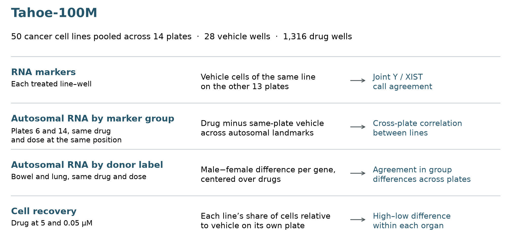
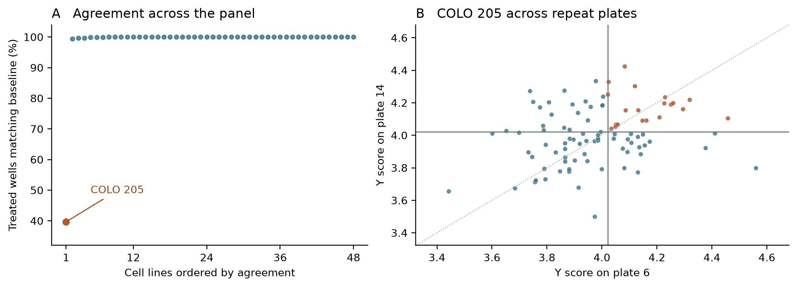
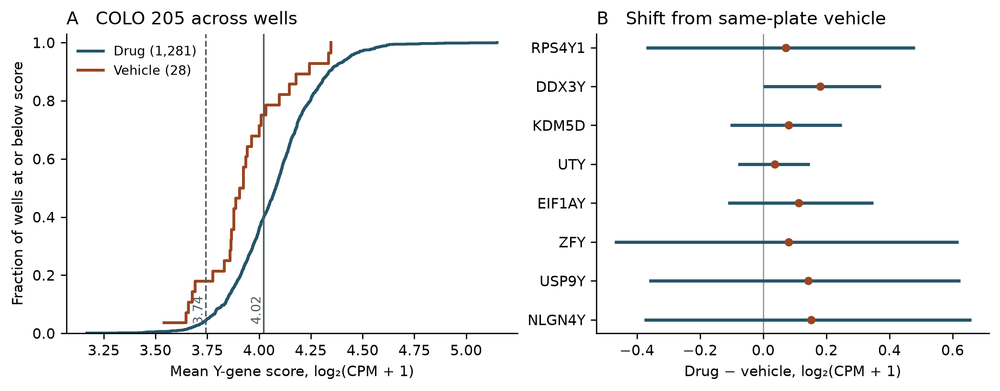
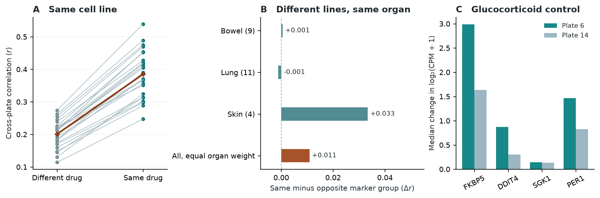
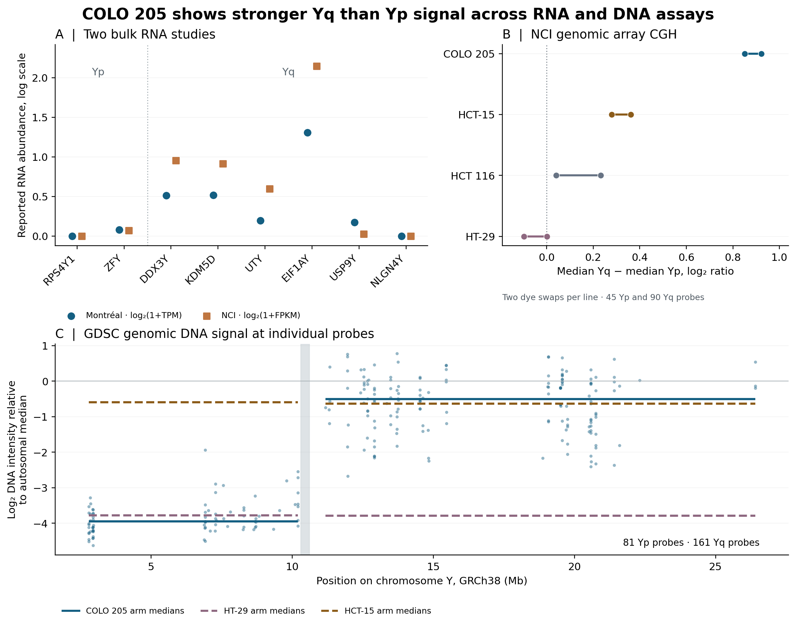

# Do sex-chromosome RNA markers persist after drug exposure in cancer cell lines?

## Abstract

Expression of Y-linked genes and XIST can be measured in untreated cell lines. Using these measurements to interpret a drug screen assumes the expression pattern persists after treatment. We tested that assumption in Tahoe-100M by comparing 58,259 drug-treated cell line–wells with vehicle cultures of the same line. Both markers retained their baseline classification in 98.71% of wells when each line received equal weight. One colorectal line, COLO 205, accounted for 773 of 792 disagreements. Its median Y score lay close enough to the cutoff that switching between two archived classification rules changed its agreement from 39.7% to 95.8%. For all 24 eligible lines, 948-gene profiles correlated more strongly when drug and well position matched across plates. Sharing a baseline marker group added an estimated 0.011 to the between-line response correlation (exact permutation p = 0.204). A comparison using recorded donor sex in 19 lines also found little evidence of a reproducible drug-dependent group difference. Two external RNA-seq studies and independent DNA arrays showed stronger signal on the measured long arm of chromosome Y than on its short arm in COLO 205. A baseline RNA call described most treated cultures well. The continuous measurements in COLO 205 show how a modest expression shift can look like a change of chromosome state.

## Introduction

Cancer cell lines can lose sex-chromosome material during culture, and chromosome complement can influence gene essentiality [1]. The preceding Fatima Fellowship study compared donor annotation with expression of Y genes and the X-inactivation transcript XIST. Of 49 Tahoe lines with a donor annotation, 27 showed a different RNA pattern from the conventional expectation. External RNA sequencing agreed with the Tahoe classifications in 47 of 49 comparable lines [2]. These observations motivated a more immediate question. When a vehicle culture expresses a particular marker pattern, does the same line still express it after exposure to a drug?

Tahoe-100M profiled pooled, drug-treated cancer cell lines by single-cell RNA sequencing [3]. The atlas allows marker expression and response to be measured in the same cultures. We first tested the persistence of the baseline markers. We then asked whether lines with similar marker expression also share an autosomal response to the same drug. This second question requires genes outside the X and Y chromosomes, comparisons within the same organ and measurements on repeat plates. Finally, we examined whether the baseline groups differed in how many cells of each line were recovered at different drug concentrations.

## Methods

**Figure 1. Which observations enter each comparison?** A line–well is the set of captured cells from one cell line in one pooled well. The first comparison measures persistence of two markers. The next two comparisons use autosomal expression to test baseline marker groups and recorded donor labels. The final comparison uses the number of recovered cells. Replicate plates 6 and 14 used the same drug and dose at the same well position.

**Marker persistence.** We used every cell passing the atlas quality filter. Within a line–well, we summed unique RNA molecules for each gene, divided by total molecules in that line–well and transformed the result to log₂(1 + counts per million). The Y score averages eight such gene scores. XIST supplies the second score. For wells with at least 200 cells of the line, we classified each score using the cutoffs from the earlier study. We compared the two calls jointly with those obtained by pooling vehicle cells of that line from the other 13 plates. The reference excluded the target plate, although the original cutoff estimation used all vehicle plates. Each line received equal weight in the primary agreement estimate. We separately report the total discordant line–wells.

**Autosomal expression.** We used the two repeated plates and selected measured L1000 landmark genes [4] mapping uniquely to autosomes. For each drug, dose, line and plate, we subtracted the same line’s pooled vehicle expression from its treated expression, gene by gene. Among different lines from the same organ we correlated the response vector on one plate with the second line’s vector on the other. We averaged both plate orientations and shared drug conditions. The planned contrast compares pairs of lines in the same baseline group with pairs in different groups, giving organs equal weight. A line expressing either Y or XIST belongs to one group, a line expressing neither to the other. Permuting whole-line labels preserves repeated observations from each line. Comparing a line to itself on the other plate tests whether an expression signal repeats. A supplementary analysis used annotated donor sex directly. It compared male-minus-female expression differences for matched drugs in bowel and lung (Supplement S11). We also checked whether four glucocorticoid-responsive genes shifted in the expected direction after triamcinolone [5].

**Relative recovery.** We calculated each line’s share of recovered cells relative to vehicle on the same plate and compared 5 µM with 0.05 µM for 379 named compounds. We averaged across compounds within line and then compared marker groups within organ. The eligible bowel, lung and skin panel contained 26 lines. A line’s share depends on the growth and recovery of every line in its well. Pooled wells and repeated well positions also limit the independence of observations [6]. The supplement gives the calculation and the exact whole-line permutation test.

**External COLO 205 samples.** We compared the eight original Y transcripts in two bulk RNA-seq studies. For DNA, we read probe-level genomic array CGH, three 450K methylation-array intensity series and the raw Broad CCLE SNP 6.0 array. On the methylation arrays we summed the two DNA channels. All arm contrasts were calculated within a specimen using non-pseudoautosomal probes. We also retrieved the original spectral karyotype [9, 10, 11, 12]. Supplement S12 identifies the samples, comparison lines and shared stocks.

## Results

### Baseline marker calls persisted in most treated cultures

The atlas contained 95,624,334 passing cells. Of 65,800 possible treated line–wells, 58,259 from 48 lines met the 200-cell criterion. Of these, 57,467 retained both baseline marker calls (98.64% pooled, 98.71% weighting lines equally). Across the 47 lines with both eligible vehicle and treated wells, agreement was 99.47% in vehicle and 98.68% after treatment. The paired difference was −0.78 percentage points (descriptive 95% line-bootstrap interval −2.30 to −0.01). Equalizing the molecule counts in eligible treated and same-plate reference libraries gave 98.98% agreement.

**Figure 2. Agreement by cell line and by replicate well.** Left, each point is one line’s fraction of eligible treated wells matching its vehicle reference. Right, continuous Y scores for the 93 matched drug–dose conditions in COLO 205. The solid lines mark the original Y cutoff on each plate. The 20 orange points crossed it on both plates.

### Two archived cutoffs gave opposite interpretations for COLO 205

COLO 205 contributed 773 of the 792 treated disagreements, and all seven vehicle disagreements. Its median Y score was 3.915 in vehicle and 4.081 after treatment. Across all lines on plates 6 and 14, 4,104 of 4,142 matched line–drug–dose pairs agreed with each other. All 38 disagreements involved COLO 205. In 20 further pairs both plates crossed from the original vehicle classification of neither marker to Y-positive. The earlier supplement documented this line’s proximity to the cutoff, its different call under the alternative rule, and its disagreement with external RNA data [2]. The treated wells show the consequences of that ambiguity.

An alternative pair of cutoffs, fitted in the earlier project to pooled lines, classified the COLO 205 baseline as Y-positive. Using that rule, 1,227/1,281 treated wells matched baseline, compared with 508/1,281 under the original rule. Only two pairs on the repeat plates crossed consistently away from the alternative baseline, both toward Y-negative. Individual Y genes showed small, overlapping shifts relative to vehicle (Figure 3). The largest median was +0.180 log₂ units for DDX3Y. These data measure RNA abundance. They cannot by themselves establish a change in chromosome copy number.

**Figure 3. The Y-score boundary in COLO 205.** A, empirical cumulative distributions across all eligible drug and vehicle wells. Vertical lines mark the two archived Y cutoffs. B, within each treated well, the gene score minus its same-plate pooled vehicle score. Points are medians of 1,281 treated wells and bars span the middle half of observed differences. The case was selected after observing its contribution to discordance. The pooled drug distribution does not estimate a specific drug effect.

### Drug responses repeated within cell lines, with little additional agreement by marker group

The two plates contained 13,486,933 cells across 50 lines before eligibility filtering. Twenty-four of the 26 candidate lines met the vehicle-depth requirement on both plates. The resulting 2,218 matched line–drug–dose observations covered 93 conditions. All but one used 5 µM. In all 24 lines, expression changes across 948 autosomal genes correlated more strongly between plates for a matched condition than for mismatched conditions. The line-averaged correlations were 0.385 and 0.201, respectively. Because matched drug conditions also matched well positions, some of this advantage may reflect position. As a separate biological control, median expression increased for FKBP5, DDIT4, SGK1 and PER1 on both plates after exposure to 5 µM triamcinolone.

Do two *different* lines from the same organ respond more similarly if they share a baseline marker group? Across 97 pairs, the mean difference between same-group and opposite-group correlations was +0.0109 (exact two-sided p = 0.204, 249,480 whole-line label arrangements). The organ contrasts were +0.0006 in bowel, −0.0012 in lung and +0.0334 in skin. Omitting the four skin lines brought the average to −0.0003. The expression assay recovered drug-associated signal within a line. It gave little evidence that a shared marker label predicts response similarity across lines.

**Figure 4. Separating a reproducible expression response from agreement between cell lines.** A, each thin line follows one cell line across mismatched and matched conditions on plates 6 and 14. B, the excess correlation for same-group versus opposite-group pairs within each organ, with the mean giving organs equal weight. C, median treated-minus-vehicle expression for four glucocorticoid-responsive genes in 43 eligible lines on each plate.

Nineteen lines also allowed a direct comparison by recorded donor sex. We asked whether the same drug-specific male-minus-female differences across genes recurred on the second plate more strongly than for arbitrary groups of the same sizes. For 93 drug–dose conditions in bowel and 89 in lung, the observed average cross-plate product of those differences was 0.00337. The mean across all 11,550 within-organ label assignments was 0.00344 (one-sided p = 0.571). This panel showed little evidence of a general drug-dependent donor-label difference. Drug-specific responses in individual lines remain possible (Figure S2).

### Relative recovery showed little average difference by marker group

In the 26-line panel, 12 lines expressed Y genes or XIST and 14 expressed neither. The estimated group difference in high-minus-low relative recovery was −0.00514 log₂ units (95% model-based interval −0.0673 to 0.0570). Across all 972,972 within-organ label arrangements, the two-sided permutation p was 0.852. A target-specific control, adagrasib, produced a larger relative depletion of KRAS G12C lines (−0.438 log₂ units), consistent with its known target [7]. Just 26 compounds had both doses on the same plate, and only one remained after exclusion of plate 13. Opposing drug-specific effects could average to zero.

### External cultures showed stronger Yq than Yp signal in COLO 205

In the Montréal ATCC sample, RPS4Y1 was undetected and ZFY measured 0.058 TPM. Four long-arm genes, DDX3Y, KDM5D, UTY and EIF1AY, each exceeded both short-arm genes in Montréal and in the NCI RNA-seq data. NLGN4Y was undetected in both. The DNA measurements gave a corresponding positional result. The two NCI dye-swap arrays had the largest long-minus-short-arm contrasts in the 129-array series. In the independently grown, ATCC-sourced Broad sample, the contrast across 2,552 short-arm and 5,879 long-arm probe sets was +1.395 log₂ units. The same contrast was +0.054 in HCT-15 and −0.073 in HT-29 [9, 10]. The archived NCI karyotype recorded loss of an identifiable Y in nine metaphases [11].

**Figure 5. The arm difference across RNA and DNA assays.** A, RNA abundance for each marker in two separate bulk studies. Each study retains its own expression units. B, each point is one NCI comparative genomic hybridization array. Paired dyes measure the same comparison in opposite labeling directions. C, individual Sanger/GDSC DNA probes after autosomal centering, with reference-line medians. All three panels cover the same named cell line. The RNA and DNA came from separate sample preparations.

## Discussion

For most lines, a Y/XIST classification from vehicle culture also described the drug-exposed sample. COLO 205 shows the limit of interpreting a thresholded score as a change in biological state. Its baseline fell between two previously fitted Y cutoffs. The two rules reversed both the baseline call and the direction of reproducible crossings. Reporting expression continuously preserves information that a two-state call discards. XIST transcription can itself change after epigenetic treatment [8]. Neither RNA score is a direct assay of chromosome complement.

The autosomal result narrows the interpretation further. On the two repeat plates, the same line often preserved the ordering of gene responses to a drug. Knowing that a different line shared its Y/XIST group added little information about the shape of its response. Correlation is insensitive to a common change in effect magnitude. The comparison covered only three organs, pooled two distinct marker-positive states, and used just two plates with shared well positions. A small state-specific or drug-specific effect could survive those limitations.

The external arrays support a regional difference in Y-derived material and help explain why combining Y genes into one score was misleading for COLO 205. A small fragment carried on another chromosome is one possible explanation. Its physical location and the proportion of cells carrying it remain unknown. The decisive follow-up would pair DNA and RNA from the same culture with a method that localizes the retained material. Randomizing drug and vehicle positions across plates would separate drug from well position. Pairing RNA measurements with Y copy number and absolute viable-cell counts would distinguish changes in expression, chromosome dosage and cell recovery. Those distinctions matter before applying a result from pooled cancer cell lines to differences between patients.

## Data and contributions

Mateenah Jahan and Marouen Ben Guebila are the authors of the preceding fellowship manuscript [2]. Codex designed and ran these follow-up analyses and prepared this report for their review. The [whole-plate count reconstruction](marker_transfer/independent_check.json), [autosomal counts and analysis](genomics_extension/README.md) and [donor-label analysis](donor_response/analyze.py) accompany the supplement.

## References

1. Shohat S, Vol E, Shifman S. Gene essentiality in cancer cell lines is modified by the sex chromosomes. *Genome Research*. 2022. [Article](https://doi.org/10.1101/gr.276488.121)
2. Jahan M, Ben Guebila M. Sex-chromosome expression and annotated donor sex in drug-perturbation cell lines. Fatima Fellowship manuscript and supplement. [Archived manuscript](https://github.com/MateenahJAHAN/Project-59-CMAP-Sex-Differences/tree/893876235881d885e395eb48dbb5b13a443e5b13/manuscript)
3. Zhang J, Ubas AA, Svensson V, et al. Tahoe-100M: Mapping drug-induced molecular phenotypes at single-cell resolution. *Cell*. 2026. [Article](https://doi.org/10.1016/j.cell.2026.08.035) · [Dataset release](https://huggingface.co/datasets/tahoebio/Tahoe-100M/tree/349e2a55f5538a3e73b32a06c6bdd8e9e87011e8)
4. Subramanian A, Narayan R, Corsello SM, et al. A next generation Connectivity Map: L1000 platform and the first 1,000,000 profiles. *Cell*. 2017. [Article](https://doi.org/10.1016/j.cell.2017.10.049)
5. Piechota M, Zieba M, Borczyk M, et al. A cross-tissue transcriptomic approach decodes glucocorticoid receptor-dependent links to human metabolic phenotypes. *BMC Genomics*. 2025. [Article](https://doi.org/10.1186/s12864-025-11676-w)
6. Huang X. Cell lines that share a well are not independent observations in the Tahoe-100M drug screen. *arXiv*, preprint. [Preprint](https://arxiv.org/abs/2611.01604)
7. Ou SI, Jänne PA, Leal TA, et al. First-in-human phase I/IB dose-finding study of adagrasib (MRTX849) in patients with advanced KRAS G12C solid tumors (KRYSTAL-1). *Journal of Clinical Oncology*. 2022. [Article](https://pmc.ncbi.nlm.nih.gov/articles/PMC9362872/)
8. Tinker AV, Brown CJ. Induction of XIST expression from the human active X chromosome in mouse/human somatic cell hybrids by DNA demethylation. *Nucleic Acids Research*. 1998. [Article](https://pmc.ncbi.nlm.nih.gov/articles/PMC147638/)
9. Montréal IRIC and NCI CellMiner. COLO 205 bulk RNA-seq measurements. [ATCC-derived RNA sample GSM5857280](https://www.ncbi.nlm.nih.gov/geo/query/acc.cgi?acc=GSM5857280&targ=self&form=text&view=brief) · [NCI CellMiner data](https://discover.nci.nih.gov/cellminer/loadDownload.do)
10. Barretina J, Caponigro G, Stransky N, et al. The Cancer Cell Line Encyclopedia enables predictive modelling of anticancer drug sensitivity. *Nature*. 2012. [Article](https://www.nature.com/articles/nature11003)
11. Roschke AV, Tonon G, Gehlhaus KS, et al. Karyotypic complexity of the NCI-60 drug-screening panel. *Cancer Research*. 2003. [Authors’ archived NCI karyotypes](https://ftp.ncbi.nlm.nih.gov/sky-cgh/DATA/XML/NCI60_cell_line_panel_Genetics_Branch_I.R.Kirsch_1.xml)
12. Reinhold WC, Varma S, Sunshine M, et al. The NCI-60 methylome and its integration into CellMiner. *Cancer Research*. 2017. [Article](https://pmc.ncbi.nlm.nih.gov/articles/PMC5290136/)
