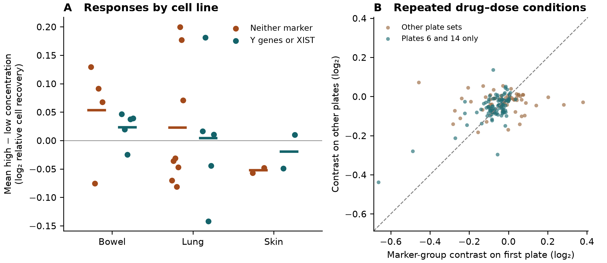
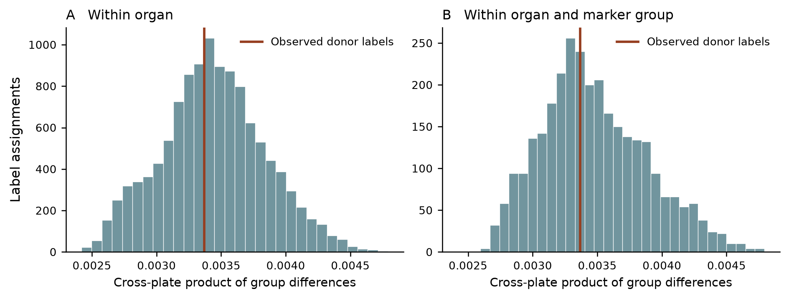
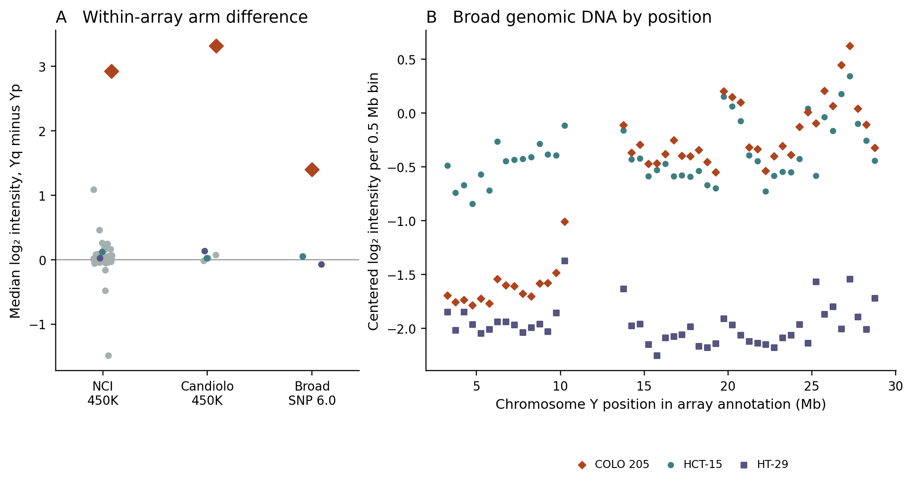

# Supplementary methods and results

## S1. Cell-level counts and marker definitions

The 14 Tahoe plates contained 93,418,548 drug-exposed and 2,205,786 vehicle cells after atlas quality filtering. The 50 lines span 67,200 possible line–well combinations. In 182 of these, no cells of the line were recovered, so no expression score can be assigned. [Atlas release](https://huggingface.co/datasets/tahoebio/Tahoe-100M/tree/349e2a55f5538a3e73b32a06c6bdd8e9e87011e8)

For each line and well, sum XIST, total UMIs and the eight Y genes RPS4Y1, DDX3Y, KDM5D, UTY, EIF1AY, ZFY, USP9Y and NLGN4Y. Normalize each gene to counts per million total UMIs and take log₂(CPM+1). The Y score is the mean of the eight log-transformed Y values. XIST at or above 4.68498 and Y at or above 4.02168 give two binary indicators. Their four possible combinations are neither (0), Y only (1), XIST only (2) and both (3). Pooling all vehicle cells reproduced all 50 archived line-level combinations. For each test well, the reference pooled vehicle counts from the same line on the remaining 13 plates.

**Table S1. Agreement with the vehicle reference under different minimum cell counts.** The percentages weight eligible lines equally. Vehicle wells are allowed different coverage from treated wells. The paired comparison in the manuscript uses the common 47 lines at the 200-cell minimum.

| Minimum cells | Treated line–wells | Lines | Treated agreement | Vehicle line–wells | Lines | Vehicle agreement |
|---:|---:|---:|---:|---:|---:|---:|
| 50 | 61,928 | 49 | 97.55% | 1,337 | 48 | 99.40% |
| 200 | 58,259 | 48 | 98.71% | 1,263 | 47 | 99.47% |
| 500 | 52,951 | 47 | 98.72% | 1,178 | 45 | 99.38% |

Among the 48 treated lines at the primary threshold, agreement averaged 99.991% for XIST and 98.718% for Y. The line-bootstrap interval resampled the 47 common lines, retaining all wells from each sampled line, in 10,000 draws. It describes variation across this panel. Close relatives among these lines and common plate effects limit generalization. A paired sensitivity restricted to treated wells and same-plate pooled vehicle controls with at least 200 cells retained 58,188 pairs. Before thinning, agreement with that vehicle reference was 99.01%. After thinning the larger of the two pseudobulk libraries to the size of the smaller it was 98.98%. Sampling used the multivariate hypergeometric distribution over nine marker counts and the remaining UMIs with one fixed-seed draw per pair. It addresses molecule depth alone.

## S2. Discordance on replicate plates

Plate 6 and plate 14 share 93 eligible named drug–dose conditions. Exact matches within each line produced 4,142 pairs from 47 lines. The plates differed in 38 pairs. In 20 further pairs they agreed with each other and differed from the original vehicle state. COLO 205 supplied all 58 of these cases. At the 200-cell minimum, COLO 205 had 1,281 eligible treated wells out of 1,316 and all 28 vehicle wells. Its treated Y-score interquartile range was 3.942–4.203 and its vehicle range between quartiles was 3.853–4.015. Excluding this line post hoc reduced the equal-line treated-minus-vehicle agreement difference to −0.033 percentage points. The replicate plates shared well positions and the threshold did not come from external cultures. Relative-position and plate effects remain possible.

A retrospective analysis replaced the plate-level cutoffs with both pre-existing cutoffs fitted to pooled cell lines (Y 3.74152, XIST 5.52651). All 50 vehicle line calls agreed with their corresponding archived calls. On the same 58,259 treated line–wells, equal-line agreement rose to 99.78%. Across the same 47 lines with bilateral coverage, the treated-minus-vehicle difference was +0.158 percentage points. On the paired plates, 4,130 of 4,142 calls agreed with each other and two differed reproducibly from this alternative baseline. Both were in COLO 205. The thresholds were compared after COLO 205’s concentration of discrepancies became apparent. These data cannot choose between the thresholds without an independent reference.

## S3. Baseline expression and donor annotation

Among 33 male-annotated lines, 14 expressed neither marker above the thresholds and one additional line, A498, had low Y and high XIST. In total, 15 of the 33 male-annotated lines had a low Y score. Of 16 female-annotated lines, 12 had low XIST and low Y. The full panel therefore contained 27 of 49 annotated lines with an unexpected RNA pattern. A498 accounts for the difference between the low-Y count and the count with both markers low. [Recount from the archived public table](recount_baseline.py) · [Published expression table](https://raw.githubusercontent.com/MateenahJAHAN/Project-59-CMAP-Sex-Differences/d9a94ddedeb65ced19c16f6cb78497d837f161b0/analysis/data/tahoe-emeraldbay-expression-states.tsv)

The recovery comparison was specified first. Its results were known when the marker-persistence analysis was designed. The thresholds came from the earlier fellowship study. The concentration of treated-well discrepancies in COLO 205 emerged in the follow-up and motivated the alternative-cutoff and gene-level comparisons. Both studies used the same atlas. [Marker analysis](marker_transfer/analyze.py) · [Gene counts by line and well](marker_transfer/well_counts.tsv.gz) · [Analysis plan](marker_transfer/PLAN.md)

## S4. Inputs and cohort

Tahoe-100M revision 349e2a55f5538a3e73b32a06c6bdd8e9e87011e8 contains sample numbers, compound names, concentrations and cell-line identifiers. The atlas records the quality filtering applied to each profile. We used records marked `full` by the provider. Line assignments and post-QC counts can depend on genotype resolution, recovery and sequencing. The original Project 59 pipeline had already reduced the full stream to per-well counts for each line and marker stratum. Summing over all marker strata retains every passing cell. The frozen Y and XIST calls came exclusively from vehicle cells. No cell-level baseline marker was used to exclude a treated cell.

| Stage | Wells or lines | Cells or conditions |
|---|---:|---:|
| All recorded plates | 14 plates, 1,344 wells | 95,624,334 captured cells |
| Vehicle | 28 wells | 2,205,786 cells |
| Treated | 1,316 wells | 93,418,548 cells |
| Same recorded compound at 0.05 and 5 µM | 379 compounds | 379 concentration contrasts per line |
| Baseline coverage | 48 of 50 lines | ≥20 cells in each vehicle well |
| Within-organ marker comparison | 26 lines, 3 organs | 12 positive, 14 neither |

NCI-H2122 and NCI-H596 had minima of 7 and 5 vehicle cells. Among the 48 remaining lines, 22 belonged to organs without two eligible lines per marker group. Of the 65,800 possible treated well–line counts, 182 were zero, including 82 across the 26 primary lines. Zeros contributed to the calculation. Compounds are distinguished by the recorded name, including the provider's salt designations. The 379 names need not represent 379 independent mechanisms. [Cohort and exposure flags](results/lines.tsv) · [Count and state input hashes](results/inputs_sha256.json)

## S5. Statistical calculation

For well *w*, line *i* and count *n*, its log₂ share was log₂[(nᵢw + 0.5)/(Σⱼnⱼw + 25)]. Subtract the mean log₂ share in the plate's two vehicle wells for the same line. Average over replicate wells within named compound and concentration, subtract the low-concentration response from the high, then take the mean across compounds. The endpoint is the mean of within-organ differences in that line summary (either marker minus neither). An increase of one log₂ unit is a doubling of relative representation. Within each well the common log denominator cancels from a difference of group means. Vehicle referencing also cancels when contrasting two concentrations on the very same plate. For concentrations measured on different plates, the difference of the two vehicle baselines remains in the estimate.

The model-based standard error is the square root of the sum of s²/(n × m²) over organ-by-marker groups, where *m* = 3 and *s²* and *n* are the within-group sample variance and line count. The Welch–Satterthwaite degrees of freedom were 12.53. This interval conditions on the observed compounds and assumes independent cell lines within strata. Exchanges of whole marker labels within organ retained group sizes and preserved each line's observations across all wells. With 99,999 label draws, seed 591121, the two-sided *p* was 0.85077. A second implementation enumerated all 972,972 labelings and obtained 0.85241. As marker status was observed, the reference distribution assumes exchangeability within the chosen organs. This grouping does not adjust for all genetic differences among lines. No equivalence margin was specified.

## S6. Primary and sensitivity estimates

| Comparison | Lines | Strata | Difference in log₂ relative recovery |
|---|---:|---:|---:|
| Primary equal-organ mean | 26 | 3 | −0.0051 |
| Bowel (5 either, 4 neither) | 9 | 1 | −0.0298 |
| Lung (5 either, 8 neither) | 13 | 1 | −0.0184 |
| Skin (2 either, 2 neither) | 4 | 1 | +0.0328 |
| Minimum 5 cells in each vehicle well | 28 | 3 | −0.0209 |
| Minimum 50 cells in each vehicle well | 25 | 3 | +0.0022 |
| At least one eligible line of each state per organ | 35 | 5 | +0.0373 |
| Medium or high confidence baseline calls | 26 | 3 | −0.0051 |
| Stratified by both organ and known donor sex | 18 | 3 | −0.0327 |
| Omit plate 13 (367 compounds) | 26 | 3 | −0.0066 |
| Restrict to extreme doses on same plate (26 compounds) | 26 | 3 | −0.0044 |
| Same plate after removing plate 13 (1 compound) | 26 | 3 | −0.0052 |

Removing any one primary line moved the estimate to between −0.0199 and +0.0071. Omitting one organ gave −0.0241 to +0.0072. At each dose, the mean vehicle-referenced marker-group contrast was −0.0194 at 0.05 µM, −0.0340 at 0.5 µM and −0.0245 at 5 µM. The single-compound contrasts for 5 minus 0.05 µM had an interquartile range of −0.0616 to +0.0573. Their dispersion includes measurement error, biological heterogeneity and plate effects. These descriptive values do not identify drug-specific effects. [All sensitivity analyses](results/sensitivity.tsv) · [All compounds and concentrations](results/compound_contrasts.tsv) · [All line-by-compound differences](results/high_minus_low_by_drug_and_line.tsv)

## S7. Controls and repeated wells

The negative control compared the higher-numbered with the lower-numbered DMSO well on each plate, averaged across 14 plates, and applied the primary organ-balanced group contrast. Its estimate was +0.00766 (95% model-based interval −0.0308 to 0.0461). All vehicle pairs use the same baseline cultures that supplied the marker calls. The check addresses within-plate imbalance and provides no independent validation cohort. [Vehicle contrasts](results/vehicle_pairs.tsv)

Adagrasib selectively inhibits KRAS G12C. Among vehicle-eligible lines in organs containing both genotype groups, the KRAS G12C group included four lung lines (HOP62, NCI-H1792, NCI-H2030, NCI-H23) and one pancreatic line (MIA PaCa-2). Nine other lung lines and six other pancreatic lines were comparators. Giving the two organs equal weights yields −0.438 log₂ units. One stratum therefore depends on one G12C line. A target-specific positive control can demonstrate sensitivity to a particular large signal without estimating power for a smaller marker effect. [Adagrasib primary study](https://pmc.ncbi.nlm.nih.gov/articles/PMC9362872/)

Of 156 named drug–dose conditions repeated across plates, the median absolute difference between the first plate's marker contrast and the mean on other plates was 0.0403 log₂ units. The comparable median for conditions repeated only on plates 6 and 14 was 0.0313. Effects measured from common pooled wells may co-vary. Concentrations are largely assigned by plate, and the two vehicle wells per plate do not isolate plate-by-treatment interactions. The same-plate sensitivity is dominated by plate 13. A drug-level mechanism or viability claim would require independently plated observations. [Well contrasts and cell totals](results/well_contrasts.tsv) · [Replicate values](results/repeated_conditions.tsv)

**Figure S1. Relative recovery and reproducibility.** Left, the average high-minus-low relative recovery of each line across compounds, grouped by organ. Right, marker-group contrasts for 156 drug–dose conditions observed on multiple plates. Pearson’s correlation was 0.436 across these conditions and 0.701 among 93 conditions repeated only on plates 6 and 14. The latter share well positions.

## S8. Independent count and calculation checks

The byte hashes of all 14 count tables matched the stream manifest. Each table reproduced its original plate completion total. A second script independently read all 100,648,790 rows of the compact cell-annotation file, selected all 95,624,334 full-filter records, and counted them by well and cell line. The resulting 67,200 counts matched the stream tables exactly. Using log counts directly in the group contrast reproduced the primary estimate within 2 × 10⁻¹⁶. The independent calculation also supplied the exact permutation result in S5. A rerun from the supplied portable inputs reproduced all main result files byte-for-byte. This verifies the computation on this release. The two count paths derive from the same biological experiment. [Verification result](results/independent_verification.json) · [Independent implementation](verify.py)

[All treated and vehicle marker calls](marker_transfer/line_well_calls.tsv.gz) · [Marker reconstruction and threshold sensitivity](marker_transfer/independent_check.md) · [Baseline and dose comparison code](analyse.py)

## S9. Continuous expression in COLO 205

For each of the eight Y genes we subtracted the same-plate vehicle score from each eligible treated score. The vehicle denominator pools molecules across the two control wells before normalization. Medians ranged from +0.037 (UTY) to +0.180 (DDX3Y) log₂ units. Every gene's central 50% interval included zero. These distributions were calculated after the line stood out in the original marker comparison. [Gene-level quartiles](figures/colo205_gene_shifts.tsv) · [Calculation and plotted data](figures/marker_figures.py)

## S10. Autosomal gene selection, repeats and sensitivity analyses

Broad designated 978 genes as directly measured landmarks in L1000. All 978 mapped to Tahoe; removing 30 X-linked genes left 948 autosomal landmarks. We used Tahoe RNA counts for those genes. The two plates contained 94 shared named drug–dose conditions. Ninety-three provided a qualifying comparison. Each treated line–well needed 200 cells on both plates and each of its four vehicle wells needed 200 cells. NCI-H661 and SW1271 failed the vehicle criterion in the 26-line panel. The 97 eligible within-organ pairs each shared 89–93 conditions. An independent implementation recalculated every pair correlation from the count matrix and reproduced the permutation result (p = 0.2040965).

For each organ, we averaged same-group pair correlations separately in each of the two marker groups before giving those two means equal weight. We subtracted the mean for opposite-group pairs and averaged the three organ estimates. The central 95% of the shuffled statistic spanned −0.01133 to +0.01487. This is a reference distribution under whole-line exchangeability within organ. The marker groups were observed rather than randomly assigned, and organ adjustment leaves residual genetic differences. Drug identity and plate position coincide in the matched-condition control.

| Sensitivity analysis | Same-group minus opposite-group correlation |
|---|---:|
| Primary, ≥200 treated cells and ≥200 per control | +0.01091 |
| Alternate archived marker rules | +0.01320 |
| Omit COLO 205 | +0.01268 |
| Minimum 50 treated cells | +0.01090 |
| Minimum 500 treated cells | +0.01060 |
| Same set of eligible conditions for all lines in each organ | +0.01103 |
| Vehicle-only contrast, comparing the two control wells | −0.00667 |

The four glucocorticoid control transcripts were evaluated outside the 948-gene panel where necessary. The planned fifth gene, TSC22D3, mapped to chromosome X and was excluded before extracting treated counts. At 5 µM triamcinolone the median of the four-gene within-line means was +1.55 on plate 6 and +0.73 on plate 14 (43 common lines). This control tests an expected transcriptional response. It supplies no independent replication for an effect of the marker group.

[Study protocol](genomics_extension/protocol.md) · [Gene selection amendment](genomics_extension/feature_amendment.md) · [Gene list](genomics_extension/features.tsv) · [All line pairs](genomics_extension/distinct_line_pairs.tsv) · [All matched conditions](genomics_extension/coverage_by_condition.tsv) · [Independent reconstruction](genomics_extension/independent_check.json)

## S11. A matched-drug comparison using annotated donor sex

The earliest fellowship question concerned donor-labelled male and female lines exposed to the same drug and dose. We tested that grouping directly. Starting from the 24 lines eligible for the autosomal marker analysis, we required a known donor label and at least two lines in each donor group within an organ. This left eight bowel lines (four male, four female) and eleven lung lines (eight male, three female). Skin contained one eligible female line. Within each organ we retained only conditions with complete coverage of its lines on both plates. All 948 autosomal landmarks contributed.

For a given gene, cell line and plate, we subtracted the line’s average drug response across eligible drugs. This removes persistent differences between lines, including the vehicle level for that gene. We calculated the male-minus-female difference for each drug and gene separately on each plate, then multiplied the two plate differences. Differences of the same sign contribute positively. We averaged these products over genes and conditions, then gave both organs equal weight. The units are squared differences in log₂(1 + CPM). The same lines appear on both plates, so an arbitrary grouping can yield a positive average. The exact one-sided test asks whether the donor labels score higher than whole-line reassignments within organ.

| Label comparison | Assignments | Observed | Mean under reassignment | One-sided p |
|---|---:|---:|---:|---:|
| Within organ | 11,550 | 0.003368 | 0.003439 | 0.571 |
| Within organ and Y/XIST marker group | 3,024 | 0.003368 | 0.003475 | 0.560 |

**Figure S2. Do donor-label differences repeat across drug exposures?** The vertical line shows the observed cross-plate product for the recorded donor groups. The histograms give the exact reference distributions under two ways of reassigning whole lines. The same cultures supply the observed and reassigned labels. Neither comparison estimates clinical differences in treatment response.

The genome-wide marker comparison was known when this donor-label analysis was specified. We recorded the statistic before calculating donor-label outcomes. A direct implementation and a matrix implementation agreed for every organ-level assignment. The statistic summarizes drug-dependent differences over the panel and cannot exclude effects confined to a small number of genes or drugs. [Protocol](donor_response/protocol.md) · [Complete results](donor_response/results.json) · [All qualifying conditions](donor_response/eligible_conditions.tsv) · [Both implementations](donor_response/analyze.py)

## S12. Independent COLO 205 specimens

Montréal documented ATCC as the source of its culture. Its RNA-seq estimates are TPM, while NCI CellMiner reports log₂(FPKM + 1); cross-study comparisons therefore concern direction. Across the original two Yp genes and six Yq genes, the difference between arm medians was +0.314 in log₂(TPM + 1) in Montréal and +0.720 in NCI's units. The Montréal transcript quantification contained no identifiable XIST entry. NCI reported XIST at 0.024 log₂(FPKM + 1). [Gene-level RNA measurements](independent_colo205/results/rna_genes.tsv)

| Genomic DNA source | Platform | Yq − Yp in COLO 205, log₂ units | What the comparison measures |
|---|---|---:|---|
| NCI GSE48568 | Agilent array CGH | +0.852 and +0.922 | Two dye orientations, 45 short-arm and 90 long-arm probes |
| NCI GSM2087430 | Illumina 450K | +2.924 | Sum of methylated and unmethylated probe signals |
| Candiolo GSM2293091 | Illumina 450K | +3.314 | New assay of an NCI-supplied stock |
| Sanger/GDSC GSM1669683 | Illumina 450K | +3.437 | Independently deposited specimen on the same probe design |
| Broad/CCLE GSM888007 | Affymetrix SNP 6.0 | +1.395 | ATCC stock cultured for CCLE, nonpolymorphic probe sets |

Each contrast is calculated within a platform. The table contains technical repeats and some stocks with common provenance. Counting probes or dye swaps as independent cultures would inflate replication. In the Melbourne study, the released genotype and intensity matrices both contained 584,888 autosomal loci and no sex-chromosome measurements. That series supplies no Y result. The public Broad gene table also omitted the eight Y estimates. Its raw CEL file retained the relevant measured intensities. [Source and culture records](independent_colo205/README.md) · [Melbourne coverage](independent_colo205/results/wehi_coverage.tsv) · [CCLE raw-data analysis](independent_colo205/nci_dna/README.md)

**Figure S3. Raw DNA signal in three sample collections.** Left, within-array arm differences. Orange diamonds mark COLO 205, teal HCT-15 and purple HT-29. Each additional gray point is a comparison line with an NCI amelogenin fingerprint. Right, median autosome-centered signal in 0.5 Mb bins on the Broad array, using its native annotation. Gaps mark intervals without retained probes. The same-platform controls have similar short- and long-arm intensities. COLO 205 differs sharply between arms.

The Candiolo processed matrix retained just 13 of 81 Yp probes for COLO 205. Reading the raw red and green IDATs recovered all 81 and reproduced intensities wherever the deposited matrix had a value. For CCLE, removing flagged physical features changed the contrast from +1.395 to +1.394. The probe-level results do not identify a structural breakpoint or supply an absolute chromosome count. [Complete 450K arm measurements](independent_colo205/nci_dna/complete_arm_medians.tsv) · [CCLE probe-set and flag sensitivity](independent_colo205/nci_dna/broad_summary.tsv) · [Original spectral karyotype, case 2801](independent_colo205/results/sky_case_2801.xml)
